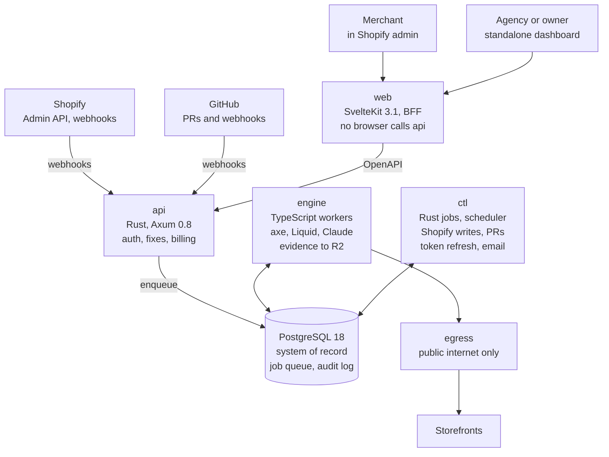
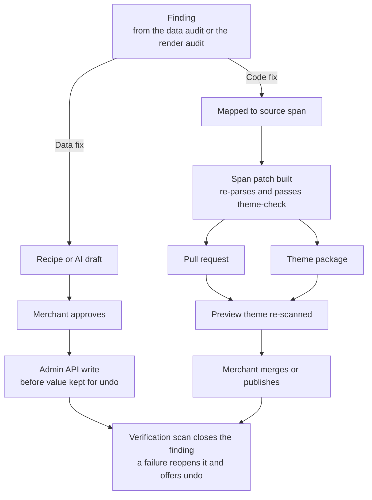
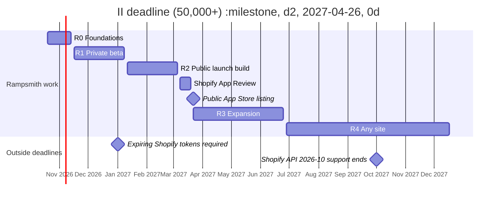

# Rampsmith — Enterprise Build Plan

Oct 17, 2026 · @Billy Ribeiro

## 1. Executive summary

Rampsmith is a self-serve Shopify app that finds WCAG 2.2 AA failures, fixes them in the store's own source and data, and keeps a dated remediation record. WordPress follows in phase 2 and any Git-hosted site in phase 3.

**Name.** A ramp is the universal symbol of access; a smith is a craftsman who repairs things at the source. Two names were rejected on evidence: *Curbcut* is already used by several Shopify accessibility apps, and *Lintel* collides with existing open-source developer tools. Trademark clearance and domain registration are week-1 tasks (section 25).

**Wedge.** Overlay widgets are cheap but do not fix code, and the FTC fined the largest one $1 million for claiming they did. Source-code remediation exists, but it is sales-led and priced in the thousands per month. Rampsmith sells source-level fixes self-serve, at overlay-adjacent prices (section 20).

**How fixes ship.** Shopify does not let App Store apps write theme files without a rarely granted exemption (section 4). Every fix therefore ships through one of three compliant channels:

1. **Store data fixes**: alt text, product descriptions, pages and menus, written through the Admin GraphQL API with merchant approval and one-click undo.
2. **GitHub pull requests**: theme code fixes for stores whose theme is connected through Shopify's GitHub integration.
3. **Patched theme package**: a fixed copy of the theme the merchant or their developer installs as an unpublished theme. Rampsmith re-scans that theme's preview before anything is published.

**Stack.** SvelteKit 3.1 with Svelte 5 for the web, Rust 1.99 with Axum 0.8 for the control plane, PostgreSQL 18 on Railway. The scanning and patching engine is TypeScript, because axe-core, Playwright, Shopify's Liquid parser and the Claude SDK are all first-party JavaScript libraries with no Rust equivalent of the same standing (ADR-002).

**Economics.** Alt-text generation on Claude Haiku 5.5 through the Batch API costs roughly $0.10 per 1,000 product images (section 13). Infrastructure starts on usage-based Railway billing, so cost scales with customers rather than ahead of them.

**Non-negotiable.** Rampsmith never claims a site is "compliant" or "lawsuit-proof". The FTC's order against accessiBe and WordPress.org's plugin rules both make that claim a liability (section 3).

The launch strategy is the next working session and is deliberately out of scope here.

## 2. Evidence base

Demand is forced by law, rising, and concentrated on Shopify, and the cheap incumbent fix demonstrably fails. Every row below was read from the linked page; the product decision each one drives is in the last column.

| Finding | Number | Source | What it decides |
| --- | --- | --- | --- |
| Federal website accessibility lawsuits, 2025 | 3,117, up 27% from 2,452 in 2024; New York 1,021, Florida 961 | [Seyfarth Shaw](https://www.adatitleiii.com/2026/03/federal-court-website-accessibility-lawsuit-filings-bounce-back-in-2025/) | Demand is legally forced. State-court suits and demand letters come on top of this count. |
| ADA website suits naming Shopify stores, H1 2025 | 653 of 2,014 (32.4%) | [EcomBack](https://www.ecomback.com/ada-website-lawsuits-recap-report/2025-mid-year-ada-website-lawsuit-report) | Shopify is the single largest platform target, so it is channel one. WordPress (403 suits) is channel two. |
| Suits against sites with an accessibility widget installed, H1 2025 | 456 (22.6%) | [EcomBack](https://www.ecomback.com/ada-website-lawsuits-recap-report/2025-mid-year-ada-website-lawsuit-report) | Overlays do not stop suits. Source fixes plus a dated remediation record are the defensible product. |
| Home pages with detectable WCAG 2 failures, Feb 2026 | 95.9%, averaging 56.1 errors per page | [WebAIM Million 2026](https://webaim.org/projects/million/) | Almost every prospect has fixable issues on day one, so the free scan always finds something real. |
| Errors that fall into six categories | 96% | [WebAIM Million 2026](https://webaim.org/projects/million/) | The fix catalog starts with those six (chart in section 12). |
| Average errors on Shopify home pages | 75.1, against 56.1 overall and 52.8 on WordPress | [WebAIM Million 2026](https://webaim.org/projects/million/) | Shopify storefronts are worse than average, so each install carries more fixable value. |
| FTC order against accessiBe, April 2025 | $1 million; barred from claiming automated tools make any site WCAG-compliant without evidence | [FTC](https://ftc.gov/news-events/news/press-releases/2025/04/ftc-approves-final-order-requiring-accessibe-pay-1-million) | The claims policy in section 3 is a hard product requirement, not marketing taste. |
| European Accessibility Act | Applies since 28 June 2025; e-commerce is in scope; service microenterprises (under 10 staff and at most €2M turnover or balance sheet) are exempt | [e-include](https://e-include.eu/web-accessibility/european-accessibility-act/) | EU-selling merchants are a second forced-demand pool, so the product ships multi-language and EUR-aware from v1. |
| ADA Title II rule for state and local government | WCAG 2.1 AA; deadlines moved to 26 April 2027 (population 50,000+) and 26 April 2028 | [Jackson Lewis](https://jacksonlewis.com/insights/doj-extends-public-entities-compliance-deadline-ada-related-website-accessibility-hhss-may-2026-deadline-still-looms) | A phase-3 public-sector segment with a hard date, served by the Git and generic-site channel. |
| Automated detection ceiling | axe-core finds on average 57% of WCAG issues | [axe-core](https://github.com/dequelabs/axe-core) | Reports must state what automation cannot see, and a manual-review queue is part of the design. |
| Solo-founder revenue, Stripe Atlas cohorts | Median B2B more than 4x median B2C at month 24; top decile earns 51% of revenue abroad against 2% for the median | [Stripe](https://stripe.com/blog/top-solo-founder-traits) | Sell to businesses, AI-native, international from launch. |
| Shopify App Store revenue share | 0% on the first $1M of lifetime app revenue counted from 1 January 2025, then 15% | [Shopify](https://shopify.dev/docs/apps/launch/distribution/revenue-share) | Shopify billing is effectively free for the first $1M, so it is the default billing rail. |

The competitor pricing gap is drawn in section 20, where it sets the price points.

## 3. Product definition

The v1 customer is a Shopify merchant selling to US or EU consumers, plus the agencies that run those stores. TechLion reports that two-thirds of 2025 web-accessibility defendants had under $25 million in annual revenue, without naming its dataset ([TechLion](https://www.techlion.dev/blog/ada-website-compliance-nj-small-business-2026)); treat the figure as directional. Either way, the paying core is small and mid-sized stores, not enterprises.

### Personas

| Persona | Who | What they pay for | Primary channel |
| --- | --- | --- | --- |
| Merchant owner | Non-technical founder or operator, 1–20 staff | Exposure ranked in plain language; fixes without touching code; proof of effort | Data fixes, patched theme package |
| Agency developer | Freelancer or agency running 5–100 client stores | Exact patches, pull requests, client-ready reports, one dashboard for every store | GitHub pull requests, patched theme package |
| In-house e-commerce team | Shopify Plus brand with a developer on staff | Continuous monitoring, regression alerts, audit trail | GitHub pull requests |

### Jobs the product must do

1. Show where the store is exposed, ranked by user impact and by how often that failure appears in complaints.
2. Fix everything fixable without the merchant writing code.
3. Hand a developer exact, reviewable patches for the rest.
4. Keep it fixed as themes, apps and products change.
5. Produce a dated remediation record and an honest accessibility statement.

### Scope boundaries for v1

| In scope | Out of scope, and why |
| --- | --- |
| Automated WCAG 2.2 A/AA checks across page types and interactive states (menus, cart drawer, modals, variant pickers) | A toolbar or overlay widget: it does not fix source and does not stop suits (section 2) |
| Store data fixes through the Admin API | Shopify-controlled checkout pages: not theme code, so not ours to change |
| Theme code patches through pull requests or a patched theme package | Third-party app code: reported with a ready-to-send vendor notice instead |
| Continuous monitoring and regression alerts | Legal advice or an outcome guarantee: unauthorized and prohibited (claims policy below) |
| Remediation log and accessibility statement generator | A VPAT or conformance report: needs human evaluation, so it is a phase-3 partner offering |

### Claims policy (hard requirement)

The product, its listing, emails and site never state or imply that a store is compliant, certified, or protected from lawsuits. The FTC barred accessiBe from claiming automated products make sites WCAG-compliant without evidence ([FTC](https://ftc.gov/news-events/news/press-releases/2025/04/ftc-approves-final-order-requiring-accessibe-pay-1-million)). WordPress.org guideline 9 lists claiming a plugin guarantees legal compliance as dishonest conduct ([WordPress.org](https://developer.wordpress.org/plugins/wordpress-org/detailed-plugin-guidelines/)). Shopify's listing rules ban outcome guarantees ([Shopify](https://shopify.dev/docs/apps/launch/app-requirements-checklist)).

| Never | Use instead |
| --- | --- |
| ADA compliant, WCAG compliant, EAA compliant | Passes N of M automated WCAG 2.2 AA checks |
| Lawsuit-proof, protected, guaranteed | Dated remediation record of fixes applied |
| 100% accessible, certified | Barriers removed; issues automation cannot detect are listed |

Enforcement is mechanical: a `claims-lint` CI step fails the build when a banned phrase appears in any UI string, email template, listing copy or marketing page (section 24). Every report states that automated checks find only part of all issues, citing the axe-core figure.

### Product success measures

- Time from install to first applied fix: under 10 minutes.
- Data-fix acceptance rate: at least 80% of proposed fixes approved without edits.
- Regression detection: a new failure surfaced within 24 hours of the change that caused it.
- Monthly logo churn: under 3% once past the first 100 paying stores.

## 4. Platform constraints that shape the architecture

The architecture assumes Rampsmith will never hold write access to a merchant's theme files. Each constraint below was verified on the platform's own documentation; the right column is the design decision it forces.

| Constraint | Evidence | Design decision |
| --- | --- | --- |
| App Store apps cannot create, change or delete theme files without a Shopify exemption. `themeCreate` needs the same exemption. Reading theme files is allowed. | [themeCreate](https://shopify.dev/docs/api/admin-graphql/latest/mutations/themeCreate), [Built for Shopify 3.2](https://shopify.dev/docs/apps/launch/built-for-shopify/requirements) | No feature depends on theme writes. Theme code fixes ship by pull request or by a patched package the merchant installs. |
| An exemption request for single-file, merchant-approved fixes was denied as outside the eligible categories. | [Shopify developer forum](https://community.shopify.dev/t/theme-api-write-exemption-denied-is-single-file-per-change-merchant-approved-writing-ever-approvable-or-is-app-embeds-the-only-path/35406) | Apply for the developer-tooling exemption once listed, as upside only. It never sits on the critical path. |
| `fileUpdate` changes alt text on product media with the `write_files` scope. | [fileUpdate](https://shopify.dev/docs/api/admin-graphql/latest/mutations/fileUpdate) | Alt text, the second most common failure, is fixed directly with no code and no exemption. |
| A theme connected through Shopify's GitHub integration updates whenever its branch changes; admin edits commit back automatically and the sync cannot be turned off. | [Shopify GitHub integration](https://shopify.dev/docs/storefronts/themes/tools/github) | Pull requests are a first-class fix channel. Patches stay surgical so they rebase cleanly over the merchant's own edits. |
| Apps should avoid requiring manual code changes and must let merchants preview edits before publishing. | [App requirements 5.1](https://shopify.dev/docs/apps/launch/app-requirements-checklist) | The patched package is optional, framed as a developer handoff. The app delivers full value without it, and every package is re-scanned in preview first. |
| All public apps must use expiring offline tokens from 1 January 2027: 1-hour access tokens, 90-day rotating refresh tokens. | [Shopify changelog](https://shopify.dev/changelog/expiring-offline-access-tokens-required-for-all-public-apps-as-of-january-1-2027), [offline tokens](https://shopify.dev/docs/apps/build/authentication-authorization/access-token-types/offline-access-tokens) | Tokens are requested with `expiring=1` from day one, encrypted at rest, refreshed by background jobs, and rotated atomically (section 14). |
| Embedded apps use session tokens (HS256, one-minute lifetime) and the token-exchange grant. | [Session tokens](https://shopify.dev/docs/apps/build/authentication-authorization/session-tokens), [token exchange](https://shopify.dev/docs/apps/build/authentication-authorization/get-access-tokens/exchange-tokens) | The Rust API verifies every session token and performs token exchange itself. No Shopify-specific framework is required. |
| Polaris is now web components loaded from Shopify's CDN and works with any framework. | [Polaris unified](https://www.shopify.com/partners/blog/polaris-goes-stable-the-future-of-shopify-app-development-is-here), [App Home](https://shopify.dev/docs/api/app-home/latest/web-components) | The embedded admin is SvelteKit with Polaris web components, not React. |
| New public apps must use the GraphQL Admin API. 2026-10 is the latest stable version, supported until at least 1 October 2027. | [2026-10 release notes](https://shopify.dev/changelog/release-notes/2026-10) | Pin API version 2026-10. Upgrade on a fixed quarterly cadence with schema-diff tests. |
| Built for Shopify needs admin LCP at most 2.5 s, CLS at most 0.1 and INP at most 200 ms at p75, storefront impact at most 10 Lighthouse points, 50 net installs and 5 reviews. | [Built for Shopify](https://shopify.dev/docs/apps/launch/built-for-shopify/requirements) | These numbers are CI performance budgets from the first commit (section 23). |
| Shopify App Pricing hosts the plan page, allows 8 public plans and usage meters, bills in USD only, and sends no webhook on plan changes. | [Shopify App Pricing](https://shopify.dev/docs/apps/launch/billing/managed-pricing) | Use Shopify App Pricing. Plan state comes from redirect parameters plus a Partner API check (section 20). |
| App Store apps must handle three compliance webhooks; an invalid HMAC must return 401. | [Privacy law compliance](https://shopify.dev/tutorials/add-gdpr-webhooks-to-your-app), [summary](https://docs.unified.to/skills/shopify-oauth-app/SKILL.md) | Built and tested in phase 1, not at submission (section 19). |
| Automated testing finds on average 57% of WCAG issues and returns uncertain results as "incomplete". | [axe-core](https://github.com/dequelabs/axe-core) | A review queue for incomplete results, plus keyboard and state flows that axe alone cannot exercise (section 11). |
| WordPress.org plugins must be GPL-compatible, may not lock features behind payment, may connect to a paid SaaS, and may not track users without opt-in. | [WordPress plugin guidelines](https://developer.wordpress.org/plugins/wordpress-org/detailed-plugin-guidelines/) | The phase-2 plugin is a thin GPL client of the SaaS, with no gated code and explicit opt-in (section 17). |

## 5. Release scope and acceptance criteria

Five releases take Rampsmith from an empty repository to a multi-platform product; each one ends on measurable exit criteria, not a date. Dates live in the roadmap (section 26).

| Release | Ships | Exit criteria (all must pass) |
| --- | --- | --- |
| R0 Foundations | Monorepo, CI gates, migrations, job queue, OpenTelemetry, `claims-lint`, accessible design-system primitives, Shopify dev store wired | Clean build with zero warnings in Rust, TypeScript and Svelte; queue survives a worker kill mid-job with no lost or duplicated job; design primitives pass axe with zero violations |
| R1 Private beta | Embedded Shopify app; scans of 8 page types and 4 interactive states; ranked issue list; AI-drafted alt text with approve, edit and undo; remediation log; accessibility statement generator; weekly rescans | 10 design-partner stores installed; install-to-first-fix median under 10 minutes; at least 80% of alt-text drafts approved unedited; zero cross-tenant data access in the isolation test suite |
| R2 Public launch | Theme patch engine for the six top failure categories; GitHub pull-request channel; patched theme package with preview re-scan; Shopify App Pricing plans; compliance webhooks; daily monitoring and regression alerts; multi-store agency view | Shopify App Review passed; patch engine fixes at least 90% of targeted findings on the theme test corpus with zero render regressions; admin LCP, CLS and INP inside Built for Shopify thresholds in CI |
| R3 Expansion | Built for Shopify application; WordPress plugin beta; EU-language accessibility statements; manual-review queue with an expert marketplace; public API; Slack and email alerts; white-label agency reports | 50 net paid installs and 5 reviews (Built for Shopify minimums); WordPress plugin approved on WordPress.org; p95 scan completion under 15 minutes for a 500-page store |
| R4 Any site | GitHub App for any Git-hosted site using framework codemods (Svelte, React, Vue, plain HTML); a CI check that fails pull requests on new violations; public-sector Title II package; SSO for enterprise customers | Codemods pass framework test corpora with zero build breaks; CI check adopted by at least 20 repositories; first public-sector customer before the 26 April 2027 Title II deadline |

### R1 detail: the eight page types and four states

- Page types: home, collection, product, cart, search results, customer account login, standard page, blog article.
- Interactive states: main navigation opened by keyboard, cart drawer open after add-to-cart, a variant picker changed, and the first modal or popup found.

### What each fix must carry, in every release

- The finding it resolves, its WCAG 2.2 success criterion, and the before and after evidence.
- The exact change: a data diff or a code diff.
- Who approved it and when.
- A one-click undo for data fixes; a revert commit or the original theme for code fixes.
- A verification scan proving the finding is gone and nothing new appeared.

## 6. System architecture and decision records

Rampsmith is three deployables around one PostgreSQL database: a SvelteKit web app, a Rust control plane, and a TypeScript engine. They share no code at runtime; they share contracts (OpenAPI for HTTP, JSON Schema for jobs) and the database.

### Components

| Component | Language | Responsibility | Talks to |
| --- | --- | --- | --- |
| `web` | SvelteKit 3.1, Svelte 5 | Shopify embedded admin (App Bridge and Polaris web components), standalone agency dashboard, marketing site, free scanner page | `api` over Railway private networking only |
| `api` | Rust, Axum 0.8 | Auth, tenancy, Shopify OAuth and token exchange, webhook intake, fix approval workflow, billing state, report generation, job enqueueing, OpenAPI contract | PostgreSQL, Shopify, GitHub, Stripe, R2 |
| `ctl` | Rust | Rust-side jobs: token refresh, webhook processing, Shopify data writes, GitHub pull requests, email, scheduled re-scans under a single leader | PostgreSQL queue, Shopify, GitHub, Amazon SES |
| `engine` | TypeScript on Node 26 LTS | Scan (Playwright and axe-core), source mapping, Liquid patching, theme packaging, AI calls, verification scans | PostgreSQL queue, R2, Anthropic API, `egress` |
| `egress` | Rust | Forward proxy that keeps the browser on the public internet (section 18) | Merchant storefronts |
| PostgreSQL 18 | — | System of record, job queue, audit log | — |
| Cloudflare R2 | — | Screenshots, DOM snapshots, theme snapshots, patch packages, PDF reports | — |

### Decision records

Each ADR is written to `docs/adr/` as its own file before the code it governs; ADR-013 is reserved for the R3 evaluation of Shopify's Next Gen Events (section 14). The summary:

| ADR | Decision | Why | Rejected |
| --- | --- | --- | --- |
| 001 | Rust and Axum for the control plane | Your primary stack; strict types end to end; one small binary per service; Axum 0.8.9 is current | Node for everything: weaker guarantees on the money and auth paths |
| 002 | TypeScript for the engine | axe-core, Playwright, `@shopify/liquid-html-parser` and the Anthropic SDK are first-party JavaScript; Anthropic ships no Rust SDK | `chromiumoxide` in Rust: community-maintained, last release February 2026, no axe integration |
| 003 | PostgreSQL is the job queue (`FOR UPDATE SKIP LOCKED` plus `LISTEN/NOTIFY`) | One store to back up; jobs enqueue in the same transaction as the domain write; both languages can implement the protocol | Redis or a broker: another stateful service, no transactional enqueue; `pg-boss` or `apalis`: each owns its schema in one language only |
| 004 | Never write theme files; three fix channels | Shopify restricts theme writes (section 4) | Overlay widget: does not fix source, does not stop suits |
| 005 | SvelteKit is a backend-for-frontend; browsers never call `api` | One origin, tokens stay server-side, simpler CSP and CORS | Browser calls to `api`: wider attack surface, CORS against the admin iframe |
| 006 | Shared schema with `tenant_id`, enforced twice: Rust repository scoping plus Postgres row-level security | Cheap to run, and a missed `WHERE` clause still cannot leak across tenants | Schema per tenant: migration fan-out at thousands of stores |
| 007 | Patches edit source spans only; files are never reprinted | Minimal diffs, merchant formatting preserved, clean rebases in GitHub sync | Reformatting with the Liquid Prettier plugin: whole-file diffs that bury the fix |
| 008 | Shopify App Pricing for Shopify customers; Stripe Billing for everyone else | 0% Shopify revenue share on the first $1M; Stripe already runs in your other platforms | Stripe for Shopify merchants: not allowed for App Store apps |
| 009 | Contracts are generated: utoipa writes OpenAPI, `openapi-typescript` writes the web client; `schemars` writes job JSON Schema, `json-schema-to-typescript` and Ajv check it in the engine | One source of truth per boundary, and drift fails CI | Hand-written duplicate types |
| 010 | Railway first, with a measured move of browser workers to dedicated hardware | Usage billing keeps idle cost near zero; you already deploy there; native PostgreSQL PITR | Kubernetes on day one: operations cost with no customer to justify it |
| 011 | Claude Haiku 5.5 by default, escalate to Sonnet 5.5, Opus 5.5 for offline patch synthesis only | Cost per task ordered by difficulty (section 13) | One model for everything |
| 012 | No Redis in R0 to R2 | Rate limits and caches fit in Postgres and in-process; one less stateful service | Redis "just in case" |
| 016 | Node.js 26 LTS for `web`, `engine` and all tooling, on one `trixie-slim` base image | Founder decision: Active LTS at launch and supported until 30 April 2029; one runtime everywhere, pinned exactly | Node 24.22.0: maintenance-only from 20 October 2026 and end of life on 30 April 2028, 13 months after launch; Microsoft's Playwright image for `engine`: its Node version floats |

### How the parts connect



Browsers reach only `web`; Shopify and GitHub reach only `api`; and `engine` and `ctl` never call each other, they claim jobs from PostgreSQL, so either side can be redeployed or scaled alone.

## 7. Verified stack and pinned versions

Every version below was read from npm, crates.io or the vendor's release page on 17 October 2026. "Latest" means the newest stable release whose peers agree: TypeScript is pinned to 6.0.3, not 7.0.2, because SvelteKit 3.1 declares `typescript: ^6.0.0` and svelte-check declares `^5.0.0 || ^6.0.0`.

### Toolchain

| Tool | Pinned | Note |
| --- | --- | --- |
| Node.js | 26 LTS: the first 26.x release tagged LTS, due 28 Oct 2026; 26.12.0 until then | Founder decision (ADR-016). Active LTS from 28 October 2026 to 20 October 2027, then security fixes until 30 April 2029 ([release schedule](https://github.com/nodejs/Release/blob/main/schedule.json)). Node's switch to LTS changes only metadata ([24.11.0 release notes](https://github.com/nodejs/node/blob/v24.11.0/doc/changelogs/CHANGELOG_V24.md)), so 26.12.0 is the code that becomes LTS. No release merges and nothing deploys before the LTS pin. `@types/node` 26.6.5. Every package below accepts 26.12.0 in `engines.node`. |
| pnpm | 12.14.0 | Managed by mise, never Corepack |
| Rust | 1.99.1 (15 Oct 2026), edition 2024 | [Rust releases](https://blog.rust-lang.org/releases); managed by rustup, pinned in `rust-toolchain.toml` |
| PostgreSQL | 18.6 | 19 is at RC1 (15 Oct 2026); adopt it at 19.1 ([postgresql.org](https://www.postgresql.org/)) |
| mise | current | Single installer for Node, pnpm and the local PostgreSQL 18 |

### Web (`web`)

| Package | Pinned | Note |
| --- | --- | --- |
| `@sveltejs/kit` | 3.1.0 | Released 14 Oct 2026; config lives in `vite.config.ts`; `$lib` is now `#lib` |
| `svelte` | 5.57.2 | Runes only |
| `vite` | 8.3.4 | Rolldown bundler |
| `@sveltejs/vite-plugin-svelte` | 7.3.1 |  |
| `@sveltejs/adapter-node` | 6.0.0 | Railway runs the Node server |
| `typescript` | 6.0.3 | Hold until SvelteKit's peer range includes 7 |
| `svelte-check` | 4.7.7 |  |
| `openapi-typescript` / `openapi-fetch` | 7.13.0 / 0.17.0 | Typed client generated from the `api` OpenAPI file |
| `vitest` | 5.0.5 |  |
| `@playwright/test` | 1.64.1 | End-to-end and accessibility tests of Rampsmith's own UI |
| `@axe-core/playwright` | 4.14.0 | Rampsmith's own UI must pass its own scanner |
| `eslint` / `prettier` / `prettier-plugin-svelte` | 10.13.0 / 3.9.10 / 4.1.1 |  |

### Control plane (`api`, `ctl`)

| Crate | Pinned | Purpose |
| --- | --- | --- |
| `tokio` | 1.53.3 | Runtime |
| `axum` / `axum-extra` | 0.8.9 / 0.12.6 | HTTP |
| `tower` / `tower-http` | 0.5.3 / 0.7.1 | Middleware: timeouts, compression, tracing, request IDs |
| `sqlx` / `sqlx-cli` | 0.9.0 / 0.9.0 | Compile-time checked queries, migrations |
| `serde` / `serde_json` | 1.0.229 / 1.0.154 |  |
| `utoipa` | 6.0.0 | OpenAPI generation |
| `schemars` | 1.2.3 | JSON Schema for job payloads |
| `validator` | 0.21.0 | Request validation |
| `thiserror` / `anyhow` | 2.0.21 / 1.0.104 | Typed errors in libraries; `anyhow` only in binaries' `main` |
| `tracing` / `tracing-subscriber` | 0.1.44 / 0.3.23 |  |
| `opentelemetry` / `opentelemetry-otlp` / `tracing-opentelemetry` | 0.33.1 / 0.33.1 / 0.34.0 | Traces and metrics over OTLP |
| `reqwest` | 0.13.5 | rustls only |
| `jsonwebtoken` | 11.1.0 | Shopify session tokens (HS256) and GitHub App JWTs (RS256) |
| `webauthn-rs` | 0.5.5 | Passkeys for the standalone dashboard |
| `aes-gcm` | 0.11.1 | Envelope encryption of access and refresh tokens |
| `hmac` / `sha2` / `base64` | 0.13.0 / 0.11.1 / 0.23.1 | Webhook signatures, OAuth HMAC |
| `secrecy` | 0.10.3 | Secrets never reach logs or `Debug` |
| `uuid` / `time` | 1.28.0 / 0.3.55 | UUIDv7 primary keys; UTC timestamps |
| `octocrab` | 0.54.5 | GitHub App API |
| `async-stripe` | 0.41.0 | Stripe Billing for non-Shopify customers |
| `aws-sdk-s3` | 1.152.0 | Cloudflare R2 through the S3 API |
| `governor` | 0.10.4 | In-process rate limiting |
| `hickory-resolver` / `ipnet` / `url` | 0.26.3 / 2.12.2 / 2.5.8 | Server-side request forgery guard (section 18) |
| `clap` | 4.6.7 | Admin CLI |
| `insta` / `proptest` / `testcontainers` / `wiremock` | 1.49.0 / 1.12.0 / 0.28.0 / 0.6.5 | Tests |
| `cargo-nextest` | 0.9.148 | Test runner |

### Engine (`engine`)

| Package | Pinned | Note |
| --- | --- | --- |
| `playwright` | 1.64.1 | Apache-2.0; Chromium only in R0 to R2 |
| `axe-core` | 4.14.0 | MPL-2.0: used unmodified from npm, so no source-disclosure duty is triggered; any modification goes upstream or into a separate rule file |
| `@shopify/liquid-html-parser` | 2.10.2 | MIT; every node carries `position.start` and `position.end` offsets, which is what makes span patches possible |
| `@shopify/theme-check-node` | 3.30.1 | Lints every patched theme before it ships |
| `@anthropic-ai/sdk` | 0.135.0 | MIT; official SDK |
| `sharp` | 0.35.5 | Resizes images before vision calls |
| `postgres` | 3.4.9 | Queue client with `LISTEN` support |
| `ajv` / `json-schema-to-typescript` | 8.20.0 / 16.0.0 | Job payload validation and types |
| `pino` | 10.4.0 | Structured logs |
| `@opentelemetry/api` / `@opentelemetry/sdk-node` | 1.9.1 / 0.223.0 |  |

### Platform APIs and models

| Item | Pinned |
| --- | --- |
| Shopify Admin GraphQL API | 2026-10 |
| Shopify CLI | 4.9.4, for app configuration and the theme app extension |
| App Bridge and Polaris | Shopify CDN script tags; Polaris pinned to a versioned release, not the floating tag |
| Claude models | `claude-haiku-5-5`, `claude-sonnet-5-5`, `claude-opus-5-5` ([models overview](https://platform.claude.com/docs/en/models/overview)) |

Upgrade policy: exact versions in `pnpm-lock.yaml` and `Cargo.lock`; Renovate opens grouped weekly pull requests; nothing merges without the full gate in section 24.

## 8. Monorepo layout and engineering standards

One repository holds a Cargo workspace and a pnpm workspace side by side. Pure logic lives in libraries; binaries only wire them together, so almost everything is testable without a network.

```text
rampsmith/
├── .mise.toml                  # node 26 LTS, pnpm 12.14.0, postgres 18
├── rust-toolchain.toml         # 1.99.1 + rustfmt + clippy
├── Cargo.toml                  # [workspace] resolver = "3", [workspace.lints]
├── pnpm-workspace.yaml
├── package.json                # root scripts only; packageManager pinned
├── crates/
│   ├── domain/                 # pure types, no I/O: Tenant, Store, Page, Finding, Fix, Criterion
│   ├── db/                     # sqlx repositories, migrations/, tenant-scoped executor
│   ├── queue/                  # job protocol: enqueue, claim, heartbeat, complete, fail
│   ├── shopify/                # session tokens, token exchange and refresh, typed GraphQL ops, webhook HMAC
│   ├── github/                 # App JWT, installation tokens, branch and pull-request builder
│   ├── billing/                # Shopify App Pricing state, Stripe
│   ├── crypto/                 # envelope encryption, key rotation
│   ├── http-kit/               # problem+json errors, extractors, middleware
│   ├── telemetry/              # OpenTelemetry setup
│   ├── contracts/              # job payloads -> JSON Schema (schemars), shared API types
│   ├── api/                    # bin: Axum server
│   ├── ctl/                    # bin: Rust worker and leader-elected scheduler
│   └── rsctl/                  # bin: operator CLI
├── apps/
│   └── web/                    # SvelteKit 3.1
├── packages/
│   ├── engine/                 # Node workers: scan, map, patch, ai, verify
│   ├── contracts-ts/           # generated OpenAPI client and job types, never hand-edited
│   ├── a11y-rules/             # custom axe rules and interactive-state scripts
│   ├── liquid-patch/           # span-based Liquid and HTML patch library, pure
│   ├── ui/                     # accessible Svelte design-system primitives
│   └── tsconfig/               # shared strict configs
├── extensions/
│   └── theme-app-ext/          # Shopify theme app extension: statement link and feedback form
├── plugins/
│   └── wordpress/              # phase 2, PHP
├── corpus/                     # theme test corpus and golden findings
├── infra/                      # Dockerfiles, Railway service configs, collector config
├── docs/
│   ├── adr/
│   ├── runbooks/
│   └── threat-model.md
└── .github/workflows/
```

### TypeScript and Svelte standards

- `strict`, plus `noUncheckedIndexedAccess`, `exactOptionalPropertyTypes`, `noImplicitOverride`, `noPropertyAccessFromIndexSignature`, `verbatimModuleSyntax` and `isolatedModules`.
- ESLint 10 with `typescript-eslint` 8.71.2 and `eslint-plugin-svelte` 3.23.1: `no-explicit-any`, `no-non-null-assertion` and `ban-ts-comment` are errors. `knip` 6.41.0 fails the build on unused files, exports and dependencies.
- Svelte 5 runes only. `svelte-check --fail-on-warnings`. `{@html}` is banned except for one sanitized report component with a server-side allowlist.
- All UI strings live in Paraglide JS 2.29.0 message catalogs. English ships first; the catalog structure is ready for the EU languages in R3.
- Imports use SvelteKit 3's `#lib` subpath alias.

### Rust standards

- `[workspace.lints]`: `unsafe_code = "forbid"`; Clippy `unwrap_used`, `expect_used`, `panic`, `todo`, `dbg_macro` and `print_stdout` are denied outside tests; `cargo clippy --all-targets -- -D warnings`.
- Libraries return typed `thiserror` errors. `anyhow` appears only in a binary's `main`.
- Every query is compile-time checked with `sqlx::query!` against the migrated schema, with offline data committed.
- `cargo-deny` 0.20.2 enforces the license allowlist, advisories, duplicate versions and allowed sources; `cargo-machete` 0.9.2 fails on unused dependencies.

### Shared rules

- Errors cross HTTP as RFC 9457 `application/problem+json` with a stable, enumerated `code`.
- Primary keys are UUIDv7; timestamps are `timestamptz` in UTC; money is integer minor units plus an ISO 4217 currency.
- Logs are structured and contain no personal data, tokens or theme source.
- Conventional Commits, small pull requests, and an ADR before any new runtime dependency or service boundary.
- Rampsmith's own UI meets WCAG 2.2 AA and is scanned by Rampsmith in CI.

## 9. Data model

One PostgreSQL 18 database holds every tenant in a shared schema, isolated twice: the Rust repository layer scopes every query, and row-level security rejects anything it misses. Findings are deduplicated by a stable fingerprint, so a store with 2,000 product pages that share one template shows one finding with 2,000 occurrences, not 2,000 findings.

### Tenancy enforcement

- Every tenant-owned table has `tenant_id uuid not null` and a policy `USING (tenant_id = current_setting('app.tenant_id')::uuid)`.
- The application role has no `BYPASSRLS`. A Rust `TenantTx` type opens each transaction with `SET LOCAL app.tenant_id`, and repository functions accept only `&mut TenantTx`, so unscoped access does not compile.
- System jobs run as a separate role that must still set the tenant per job. Cross-tenant reads exist only in `rsctl`, and each one is audited.
- An isolation test suite creates two tenants and asserts that every repository function returns nothing across the boundary.

### Core tables

```sql
create table tenants (
  id uuid primary key,                      -- UUIDv7 from the app
  kind text not null check (kind in ('shopify_store','organization')),
  created_at timestamptz not null default now()
);

create table sites (
  id uuid primary key,
  tenant_id uuid not null references tenants(id),
  platform text not null check (platform in ('shopify','wordpress','git','generic')),
  base_url text not null,
  verified_at timestamptz,                  -- ownership proven (install, DNS TXT, meta tag)
  verification_method text,
  primary_locale text not null default 'en',
  created_at timestamptz not null default now()
);

create table shopify_shops (
  id uuid primary key,
  tenant_id uuid not null references tenants(id),
  site_id uuid not null references sites(id),
  shop_domain text not null unique,         -- validated *.myshopify.com
  scopes text[] not null,
  api_version text not null,                -- '2026-10'
  status text not null check (status in ('installed','uninstalled','redacted')),
  installed_at timestamptz not null,
  uninstalled_at timestamptz
);

create table shopify_tokens (               -- envelope-encrypted, never logged
  shop_id uuid primary key references shopify_shops(id),
  tenant_id uuid not null,
  access_ct bytea not null,
  refresh_ct bytea not null,
  key_id text not null,                     -- which data key encrypted this row
  access_expires_at timestamptz not null,
  refresh_expires_at timestamptz not null,
  version bigint not null default 0         -- optimistic lock for atomic rotation
);

create table scans (
  id uuid primary key,
  tenant_id uuid not null,
  site_id uuid not null references sites(id),
  theme_ref text,                           -- live theme or a preview theme id
  trigger text not null check (trigger in ('manual','scheduled','webhook','verify','free')),
  status text not null check (status in ('queued','running','succeeded','partial','failed','cancelled')),
  ruleset_version text not null,            -- axe-core version + custom rules hash
  pages_planned int not null default 0,
  pages_done int not null default 0,
  started_at timestamptz,
  finished_at timestamptz,
  error_code text
);

create table findings (
  id uuid primary key,
  tenant_id uuid not null,
  site_id uuid not null references sites(id),
  fingerprint bytea not null,               -- hash(rule, normalized target, template origin)
  rule_id text not null,
  criteria text[] not null,                 -- e.g. {'1.1.1'} or {'1.4.3'}
  impact text not null check (impact in ('minor','moderate','serious','critical')),
  status text not null check (status in ('open','fixed','needs_review','accepted_risk','false_positive')),
  source_location jsonb,                    -- {file, start, end, confidence} once mapped
  first_seen_scan uuid not null references scans(id),
  last_seen_scan uuid not null references scans(id),
  occurrence_count int not null,
  unique (site_id, fingerprint)
);

create table finding_occurrences (          -- partitioned by month of capture
  finding_id uuid not null,
  scan_id uuid not null,
  tenant_id uuid not null,
  page_url text not null,
  page_state text not null,                 -- default, nav_open, cart_drawer, variant_changed, modal
  target text not null,                     -- CSS selector path from axe
  html_excerpt text not null,               -- truncated to 512 chars, scrubbed of personal data
  captured_at timestamptz not null
) partition by range (captured_at);

create table fixes (
  id uuid primary key,
  tenant_id uuid not null,
  site_id uuid not null references sites(id),
  kind text not null check (kind in ('data','code')),
  channel text not null check (channel in ('admin_api','github_pr','theme_package')),
  status text not null check (status in ('proposed','approved','applying','applied','verified','failed','reverted','rejected')),
  origin text not null check (origin in ('rule','ai','human')),
  model text,                               -- set when origin = 'ai'
  prompt_version text,
  confidence numeric(4,3),
  diff jsonb,                               -- data fixes: {resource, field, before, after}
  patch_key text,                           -- code fixes: R2 key of the unified diff
  approved_by uuid,
  approved_at timestamptz,
  applied_at timestamptz,
  verified_scan uuid references scans(id),
  reverts uuid references fixes(id)
);

create table fix_findings (
  fix_id uuid not null references fixes(id),
  finding_id uuid not null references findings(id),
  primary key (fix_id, finding_id)
);

create table audit_log (                    -- append-only; update and delete revoked from every role
  id uuid primary key,
  tenant_id uuid not null,
  actor_kind text not null check (actor_kind in ('user','system','shopify','github','operator')),
  actor_id text,
  action text not null,                     -- 'fix.approved', 'fix.applied', 'statement.published'
  subject_type text not null,
  subject_id uuid not null,
  data jsonb not null,
  at timestamptz not null default now()
);
```

### Supporting tables

| Table | Holds |
| --- | --- |
| `users`, `passkeys`, `organizations`, `memberships` | Standalone-dashboard identity; roles `owner`, `admin`, `member`, `viewer` |
| `themes` | Shopify theme id, role, snapshot key in R2, SHA-256 of the snapshot |
| `scan_pages` | Each page and state scanned: URL, page type, HTTP status, duration, screenshot key |
| `data_fix_snapshots` | Before and after values per resource and field, which powers one-click undo |
| `github_installations`, `repos`, `pull_requests` | GitHub App installs, connected theme repositories, pull-request state |
| `theme_packages` | Patched theme archives, their SHA-256, the uploaded preview theme id, the verification scan |
| `statements` | Versioned accessibility statements per locale |
| `subscriptions`, `usage_events` | Plan state per provider and metered usage |
| `ai_calls` | Model, tokens in and out, cache reads, cost in micro-dollars, batch id, prompt version, outcome |
| `webhook_events` | Provider, topic, external event id (unique), received and processed times, which makes every webhook idempotent |
| `jobs` | The queue (section 10) |

### Indexes and housekeeping

- `findings (site_id, status)`, `fixes (site_id, status)`, `scans (site_id, started_at desc)`, `audit_log (tenant_id, at desc)`.
- `finding_occurrences` partitions are created three months ahead by the scheduler and dropped after 13 months.
- Migrations are forward-only, expand-then-contract, and must run online: no long locks, `create index concurrently`, backfills in batches.

## 10. Cross-language job queue

Jobs are rows in PostgreSQL, claimed with `FOR UPDATE SKIP LOCKED` under a lease, and every side effect is idempotent, so at-least-once delivery never produces a double write. Rust (`ctl`) and TypeScript (`engine`) implement the same five operations against the same table.

### Schema and the claim

```sql
create table jobs (
  id uuid primary key,
  queue text not null,                      -- 'scan.page', 'shopify.apply_data_fix', ...
  payload_schema text not null,             -- 'scan.page@1'; consumers accept N and N-1
  payload jsonb not null,
  tenant_id uuid,
  priority smallint not null default 0,
  state text not null check (state in ('ready','running','succeeded','failed','dead','cancelled')),
  attempts int not null default 0,
  max_attempts int not null default 8,
  run_at timestamptz not null default now(),
  locked_by text,                           -- worker id
  locked_until timestamptz,                 -- lease expiry
  idempotency_key text unique,
  parent_id uuid references jobs(id),
  traceparent text,                         -- W3C trace context
  last_error jsonb,
  created_at timestamptz not null default now(),
  finished_at timestamptz
);
create index jobs_ready on jobs (queue, priority desc, run_at) where state = 'ready';
create index jobs_leases on jobs (locked_until) where state = 'running';

-- claim: one round trip, no contention between workers
with next as (
  select id from jobs
  where queue = $1 and state = 'ready' and run_at <= now()
  order by priority desc, run_at
  for update skip locked
  limit $2
)
update jobs j
set state = 'running', attempts = j.attempts + 1,
    locked_by = $3, locked_until = now() + make_interval(secs => $4)
from next where j.id = next.id
returning j.*;
```

### The five operations

1. **Enqueue** inside the same transaction as the domain write, with `ON CONFLICT (idempotency_key) DO NOTHING`, then `pg_notify('jobs', queue)`.
2. **Claim** with the query above. Workers `LISTEN` on a direct connection (never a transaction pooler) and also poll every 5 seconds, so a missed notification costs at most 5 seconds.
3. **Heartbeat** every third of the lease, extending `locked_until`.
4. **Complete** with `WHERE id = $1 AND locked_by = $2 AND attempts = $3`. The attempt number is a fencing token: a worker that lost its lease cannot complete a job someone else now holds.
5. **Fail** as retryable or permanent. Retryable failures back off exponentially with jitter, capped at one hour. Permanent failures and exhausted attempts go to `dead`, raise an alert, and are retried only through `rsctl jobs retry`.

### Queues

| Queue | Runs in | Does |
| --- | --- | --- |
| `scan.plan`, `scan.page`, `scan.finalize` | engine | Discover pages, scan one page and state, merge findings |
| `map.source` | engine | Locate the theme source span for a finding |
| `patch.build`, `package.build` | engine | Build span patches; assemble a patched theme archive |
| `ai.alt_text`, `ai.fix_synthesis`, `ai.explain` | engine | Claude calls, Batch API where latency allows |
| `verify.scan` | engine | Re-scan after a merge or on a preview theme |
| `report.render` | engine | PDF reports through Chromium print |
| `shopify.apply_data_fix`, `shopify.revert_data_fix` | ctl | Admin GraphQL writes with compare-before-write |
| `shopify.token_refresh` | ctl | Rotate expiring offline tokens |
| `github.open_pr`, `github.sync_pr` | ctl | Branches, commits, pull requests, status checks |
| `webhook.process`, `email.send`, `retention.sweep` | ctl | Webhook handling, email, data deletion |

### Rules that keep it correct

- **Idempotent effects.** Shopify writes compare the current value to the stored "before" value and stop with a conflict if the merchant changed it since. Pull requests use deterministic branch names (`rampsmith/fix-<batch id>`). Emails carry an idempotency key.
- **Fairness.** A scan never enqueues all its pages at once. The coordinator keeps a window of at most 4 running pages per scan and per-plan caps per tenant, so one large store cannot starve the rest.
- **Leadership.** The scheduler, the lease reaper and partition maintenance run only in the `ctl` instance holding `pg_try_advisory_lock` on a dedicated connection.
- **Tracing.** Every job carries the enqueuer's `traceparent`, so one trace spans webhook to scan to fix to pull request.
- **Metrics.** Depth by queue and state, age of the oldest ready job, claim latency, and attempts per job are exported and alerted on (section 21).

## 11. Scanner engine

Every scan runs two audits: a data audit that reads every product, page and article through the Admin API without a browser, and a render audit that loads a sample of pages per template in Chromium. Content failures such as missing alt text vary per product, so they are checked everywhere through the API. Template failures repeat on every page that uses the template, so rendering a few samples per template finds them at a fraction of the cost.

### Data audit (no browser)

- Read products, product media, collections, pages, blog articles, menus and the shop's locales through Admin GraphQL with cursor pagination and cost-aware throttling.
- Checks: media with empty or filename-like alt text; `descriptionHtml` and page bodies with skipped heading levels, empty links, "click here" link text, images without alt, tables without headers, and colour-only emphasis; menu items with empty or duplicate labels.
- Output: findings with exact resource ids, which become data fixes (section 12) with no source mapping needed.

### Render audit (Chromium)

1. **Plan.** Group every URL by Shopify template (each resource's `templateSuffix`) and pick samples: 3 per template on Starter, 10 on Growth, and every template variant plus 25 per template on Pro.
2. **Navigate safely.** Only the verified store domain and Shopify's CDN hosts are reachable. Each DNS answer is checked against private and reserved ranges before connecting (section 18).
3. **Load.** A fresh browser context per page, at 1280×800 and at 390×844, locale set to the store's primary locale, timezone UTC. Wait for `load`, then for the DOM to stay quiet for 500 ms, capped at 15 seconds.
4. **Check.** Run axe-core restricted to the `wcag2a`, `wcag2aa`, `wcag21a`, `wcag21aa` and `wcag22aa` tags. Best-practice results are stored separately and never counted as WCAG failures.
5. **Exercise states.** Open the main navigation with the keyboard; add an in-stock item and open the cart drawer; change a variant; open the first modal or popup. Each state is re-checked with axe scoped to the changed region. Checkout is never entered and no form with personal data is ever submitted.
6. **Run custom checks** from `packages/a11y-rules`:
   - keyboard traversal of up to 200 tab stops, flagging focus traps and stops with no visible focus indicator (2.4.7);
   - focus hidden behind sticky headers or drawers (2.4.11);
   - reflow at 320 CSS pixels with no horizontal scrolling (1.4.10);
   - text-spacing override with clipping detection (1.4.12);
   - audio or video that autoplays for more than 3 seconds with no control (1.4.2).
7. **Capture evidence.** A full-page screenshot, a crop per finding, and a scrubbed DOM snapshot, stored in R2 under tenant-prefixed keys.
8. **Fingerprint and merge.** Hash the rule, a normalized selector (positional indexes and generated ids stripped), and the template origin read from Shopify's `shopify-section-*` wrapper. Matching fingerprints across pages merge into one finding with many occurrences.

### Priority score

Each finding gets a transparent score the merchant can read: axe impact weight (critical 8, serious 4, moderate 2, minor 1) × templates affected × 2 when it sits on a purchase path (product, cart, search). Ties break on WebAIM prevalence of the failure type. The formula is printed in the app's help, so the ranking is never a black box.

### Coverage disclosure

Every report lists which WCAG 2.2 A and AA criteria were tested automatically, which partially, and which need a human. Axe's "incomplete" results enter the review queue rather than being dropped or counted as failures.

### Operating rules

- Scans run only on verified sites: installed Shopify stores, or domains proven by DNS TXT record or meta tag.
- At most one page in flight per store by default and no more than 2 requests per second; HTTP 429 triggers backoff.
- The user agent identifies Rampsmith and links to a page explaining the bot.
- Password-protected storefronts are opened with the storefront password the merchant enters, stored encrypted.
- Bot challenges are never solved or evaded. A blocked scan is reported as blocked, with instructions.
- Chromium is the version bundled with Playwright 1.64.1, pinned, so results do not drift between scans.
- Budget: one page-state at p95 under 20 seconds; an R1-sized scan of about 50 page-states under 6 minutes at 4 pages in parallel.

### Spikes to run before building on assumptions

- **S-1:** confirm the axe-core 4.14 tag set and the `target-size` rule's behaviour for 2.5.8 on the Dawn theme.
- **S-2:** scan 50 public Shopify stores and measure the bot-challenge rate for headless Chromium.
- **S-3:** confirm that an unpublished theme's share-preview link renders for an unauthenticated browser, which the verification loop in section 12 depends on.

## 12. Source mapping and fix engine

Rule-based recipes fix the six failure types behind 96% of detected errors; AI proposes fixes only where no recipe exists, and nothing AI-written ships without human approval and a passing verification scan. Data fixes go straight to the Admin API. Code fixes become span-level patches against the theme's own files.

### Mapping a rendered element to its source

Themes on Online Store 2.0 make most mapping deterministic rather than heuristic:

1. The rendered element sits inside a `shopify-section-<id>` wrapper.
2. The page's JSON template (`templates/*.json`) maps that section id to a section type, which names `sections/<type>.liquid`.
3. Within that file and every snippet or block it renders (``, ``), the Liquid AST is searched for HTML element nodes matching the element's tag, static attributes and class tokens. Attribute values produced by Liquid output act as wildcards.
4. Exactly one candidate above 0.9 confidence → mapped. Several candidates → Claude Sonnet 5.5 chooses among them, given the candidates and the rendered element, and must cite the distinguishing attribute. Still ambiguous → `needs_review`.
5. Page-wide failures map straight to `layout/theme.liquid`; colour failures driven by theme settings map to `config/settings_data.json`.

### Fix catalog, in build order

Six failure types cover 96% of detected errors; low contrast leads at 83.9% (WebAIM Million 2026, share of the top one million home pages, February 2026):

| Failure | Home pages affected |
| --- | --- |
| Low contrast text | 83.9% |
| Missing alternative text | 53.1% |
| Missing form input labels | 51.0% |
| Empty links | 46.3% |
| Empty buttons | 30.6% |
| Missing document language | 13.5% |

The catalog is ordered by this frequency, so the first six recipes address the failures on most storefronts ([WebAIM Million](https://webaim.org/projects/million/)).

| Failure (WCAG) | Typical location | Fix | Method |
| --- | --- | --- | --- |
| Low contrast text (1.4.3) | Colour scheme settings or a CSS asset | Smallest lightness change in OKLCH that reaches 4.5:1, or 3:1 for large text, keeping hue and chroma; merchant picks from two candidates | Deterministic |
| Missing alt text (1.1.1) | Product media | Alt text drafted from the image and the product title, written with `fileUpdate` after approval | AI draft, human approval |
| Missing alt text (1.1.1) | Hard-coded theme images | Use the image object's alt, or `alt=""` with a recorded reason when decorative | Deterministic |
| Missing form labels (1.3.1, 4.1.2) | Search, newsletter, quantity inputs | Visually hidden `<label for>` using a theme translation key, added to every locale file | Deterministic |
| Empty links (2.4.4) | Icon links: cart, account, social | Visually hidden text from a translation key | Deterministic |
| Empty buttons (4.1.2) | Icon buttons: close, quantity, slider controls | `aria-label` from a translation key | Deterministic |
| Missing document language (3.1.1) | `layout/theme.liquid` | `lang="{{ request.locale.iso_code }}"` on `<html>` | Deterministic |
| No skip link (2.4.1) | `layout/theme.liquid` | Skip link to the main landmark, visible on focus | Deterministic |
| Invisible focus (2.4.7) | Base CSS asset | A `:focus-visible` outline meeting 3:1 against adjacent colours | Deterministic |
| Small targets (2.5.8) | Icon buttons and pagination | Minimum 24×24 CSS pixel hit area through padding | Deterministic |
| Skipped headings, vague link text (1.3.1, 2.4.4) | Product descriptions, pages | Corrected `descriptionHtml` through the Admin API | AI draft, human approval |
| Custom widget roles and states (4.1.2) | Carousels, custom dropdowns, accordions | Span patch for that component | AI proposal, developer review |

Translation keys matter: a label hard-coded in English would break the store's other languages, and the EAA audience reads in many.

### Patch mechanics (`packages/liquid-patch`)

- Parse with `@shopify/liquid-html-parser`; every node carries `position.start` and `position.end`.
- A fix produces edits of the form `{file, start, end, replacement}` computed from AST nodes, such as inserting an attribute just before a start tag's closing `>`.
- Edits apply from the end of the file backwards. Overlapping edits are rejected. The result must re-parse cleanly and pass `theme-check` with no new errors.
- Every recipe first checks whether its fix is already present, so re-running a recipe is a no-op.
- Output: patched files plus one unified diff per file. Files are never reformatted (ADR-007).

### AI-proposed patches

When no recipe exists, Claude receives the mapped source span, the rendered element, the failed rule and the WCAG criterion, and must return edits through structured outputs. A proposal is discarded unless it parses, passes `theme-check`, touches only the mapped span, and makes the finding disappear on a preview render. Survivors are labelled "AI-proposed" and are never applied without review.

### Verification and undo, by channel

| Channel | Verify | Undo |
| --- | --- | --- |
| Admin API data fix | Re-audit the resource and re-render one affected page | Write the stored "before" value back, only if the current value still equals the "after" value |
| GitHub pull request | Optional preview branch: the merchant connects an unpublished theme to `rampsmith/preview`; fixes land there first, Rampsmith scans that theme, then opens the pull request to the live branch | Revert pull request |
| Patched theme package | Detect the uploaded theme through the `themes/create` webhook, scan its share-preview link, show the result before the merchant publishes | Republish the original theme, which stays in the theme library |

Rampsmith never publishes a theme. Publishing stays a merchant action inside Shopify.

### The whole pipeline



Data fixes reach the store as soon as the merchant approves them; code fixes pass a preview scan first, and nothing counts as fixed until a verification scan says so.

## 13. AI subsystem

Claude does four jobs in Rampsmith, each on the cheapest model that passes its evaluation, and alt text for 1,000 product images costs about $0.10. Every call is logged with its model, tokens, cost and prompt version, and every tenant has a monthly AI budget enforced before the call is made.

### Model routing

| Task | Model | Mode | Escalation |
| --- | --- | --- | --- |
| Alt text for product media | `claude-haiku-5-5` | Batch API | To `claude-sonnet-5-5` when Haiku flags embedded text (size charts, infographics) or low confidence |
| Description and page rewrites (headings, link text) | `claude-sonnet-5-5` | Synchronous when the merchant is waiting, batch for bulk | Human review always |
| Source-mapping tie-breaks | `claude-sonnet-5-5` | Synchronous | `needs_review` when still ambiguous |
| Patches for custom widgets | `claude-opus-5-5` | Batch, offline | Developer review always |
| Plain-language explanations per rule | `claude-haiku-5-5` | Generated once per rule and locale, stored, reused for every tenant | Edited by a human before release |

Model ids are pinned snapshots. Anthropic commits to keep the current models available until at least September and October 2027 ([models overview](https://platform.claude.com/docs/en/models/overview)), so a model review is scheduled at every new release.

### Cost model for alt text

Images cost ⌈width ÷ 28⌉ × ⌈height ÷ 28⌉ visual tokens ([vision docs](https://platform.claude.com/docs/en/build-with-claude/vision)). `sharp` resizes each image to a 1008 px long edge first, so a square image costs 36 × 36 = 1,296 tokens. Haiku 5.5 on the Batch API costs $0.05 per million input tokens and $0.25 per million output tokens for prompts under 100,000 tokens ([pricing](https://platform.claude.com/docs/en/about-claude/pricing)).

```latex
\text{cost per image} = \frac{(1296 + 400)\times 0.05 + 60 \times 0.25}{10^{6}} \approx \$0.0001
```

That assumes 400 prompt tokens and 60 output tokens per image. A store with 2,000 product images costs about $0.20 to describe in full. Escalating 10% of images to Sonnet 5.5 on batch adds roughly $0.20 per 1,000 images. AI cost is therefore negligible against any plan price; the budget caps exist to stop abuse, not to protect margin.

### Prompts and outputs

- Prompts live in `packages/engine/prompts/` as versioned files. The version is stored with every call and every fix it produced.
- Every response uses structured outputs against a JSON Schema, then is validated with Ajv before use. A malformed response is a failed job, never a guess.
- The instruction prefix is identical across calls so prompt caching applies; tenant data comes after it.

### Alt-text rules given to the model

- Describe what a shopper needs: the product, its distinguishing visible attributes (colour, material, pattern, angle), and any visible text.
- Never add facts the image or the product title does not support. Never start with "image of".
- Target 150 characters or fewer; the merchant can change the limit.
- People are described by what they wear or do, never identified. Claude does not name people in images ([vision docs](https://platform.claude.com/docs/en/build-with-claude/vision)).
- Output the store's primary language. Translations of alt text into other store languages are an R3 feature.

### Evaluation harness

- A golden set of 500 product images across 20 categories, each with two human-written references.
- Automatic checks on every candidate: length, banned phrases, language, and an unsupported-attribute check graded by Sonnet 5.5 against the image and title.
- Human rating of a 50-image sample per release on a 1–5 scale by two raters.
- Gate: a prompt or model change ships only if the mean rating does not fall and unsupported attributes stay under 2%.
- Production signal: the share of drafts approved without edits, target 80% or more, tracked per prompt version.

### Data handling and resilience

- Only what a task needs is sent: the image, the product title and type, never customer data.
- Anthropic is listed as a subprocessor (section 19). Anthropic states it does not use uploaded images to train models ([vision docs](https://platform.claude.com/docs/en/build-with-claude/vision)).
- HTTP 429 and overload responses retry with backoff; a circuit breaker pauses AI queues after repeated failures, and scans continue without AI drafts.

## 14. Shopify app

The Shopify app is an embedded App Home built in SvelteKit with App Bridge and Polaris web components, backed by the Rust API for every privileged operation. It requests no theme write access and no protected customer data.

### Access scopes

Requested in `shopify.app.toml`, each one justified in the App Store submission ([access scopes](https://shopify.dev/docs/api/usage/access-scopes)):

| Scope | Why |
| --- | --- |
| `read_products`, `write_products` | Audit and correct product descriptions |
| `read_files`, `write_files` | Read media alt text; write approved alt text with `fileUpdate` |
| `read_themes` | Read theme files for source mapping and patch building (allowed without exemption) |
| `read_content`, `write_content` | Audit and correct pages, blogs and articles |
| `read_online_store_navigation`, `write_online_store_navigation` | Audit and correct menu labels; confirm coverage of menus in spike S-5 |
| `read_locales` | Detect store languages for translation keys and statements |

### Authentication

1. The app uses Shopify-managed installation: scopes come from `shopify.app.toml`, so there is no OAuth redirect dance at install.
2. Every request from the embedded UI carries a fresh session token from App Bridge, which lasts one minute. SvelteKit's server forwards it to `api` in the `Authorization` header.
3. `api` verifies the token with HS256 and the app's client secret, then checks: `aud` equals the client id; `exp` and `nbf` hold with at most 5 seconds of clock leeway; `dest` is a valid `*.myshopify.com` host; `iss` is that host's `/admin`.
4. With no valid offline token on file, `api` performs token exchange with `grant_type=urn:ietf:params:oauth:grant-type:token-exchange`, `subject_token_type=urn:ietf:params:oauth:token-type:id_token`, and `expiring=1`.
5. Access and refresh tokens are encrypted with a per-row data key (AES-256-GCM) wrapped by a master key held only in the environment.
6. Background jobs refresh any access token within 10 minutes of expiry. Refresh tokens rotate on every use, so the update is a compare-and-swap on the row's `version` column; a lost race re-reads instead of overwriting.
7. A refresh token unused for 90 days expires and forces re-authentication, so every installed shop gets at least a weekly scheduled job that keeps its token fresh.

**Spike S-4:** confirm how the initial document request carries the ID token (search parameter or header) for a non-Remix app, before building the SvelteKit hook around it.

### Admin GraphQL client

- `graphql_client` 0.16.0 generates Rust types from `.graphql` operation files checked against Shopify's 2026-10 schema, so a renamed field fails the build.
- The client reads `extensions.cost.throttleStatus` on every response and waits before the bucket runs dry. Catalog-wide data audits use bulk operations and stream the JSONL result instead of paging.
- Every mutation checks `userErrors` and maps each to a typed error. A non-empty list is a failed job, never a silent success.

### Webhooks

| Topic | Action |
| --- | --- |
| `app/uninstalled` | Mark the shop uninstalled, cancel its jobs, revoke tokens, start the retention clock |
| `customers/data_request`, `customers/redact`, `shop/redact` | Compliance handling within 30 days (section 19) |
| `themes/create` | Detect an uploaded patch package and start its preview scan; requires `read_themes` |
| `themes/publish` | Re-scan after any theme is published as the live theme; requires `read_themes` |
| `products/create`, `products/update` | Re-audit that product's data; requires `read_products` |
| `shop/update` | Refresh locales, currency and domain |

Every webhook is verified first: HMAC-SHA256 of the raw body with the client secret, base64, compared in constant time; an invalid signature returns 401. The handler stores the event, deduplicates it on Shopify's event id, enqueues `webhook.process`, and answers 200 within one second. Shopify's Next Gen Events reached general availability in 2026-10 ([release notes](https://shopify.dev/changelog/release-notes/2026-10)); ADR-013 evaluates moving to them in R3.

### App Home screens

| Route | Shows |
| --- | --- |
| `/` | Automated-check pass rate over time, open findings by impact, fixes awaiting approval, last and next scan |
| `/findings`, `/findings/[id]` | Ranked findings with evidence crops, affected templates, WCAG criterion, plain-language explanation |
| `/fixes` | Approval queue: data diffs, code diffs, before and after screenshots; approve, edit, reject, undo |
| `/code` | GitHub connection, pull requests, patched theme packages and their preview results |
| `/statement` | Accessibility statement editor and versions |
| `/settings` | Scan schedule, storefront password, AI budget, notification email |
| `/plan` | Redirects to Shopify's hosted plan page |

The UI follows Built for Shopify 4.1: `s-app-nav` for navigation, the contextual save bar for forms, `s-modal` with heading and action slots, a back button on sub-pages, no horizontal scrolling on mobile, and WCAG 2.1 AA contrast at minimum.

### Theme app extension

One app embed, off by default: an "Accessibility" footer link to the published statement, and an optional barrier-report form that posts through a signed app proxy. It ships under 5 KB of deferred JavaScript and causes no layout shift, keeping the Built for Shopify storefront impact well under 10 Lighthouse points. Uninstalling the app leaves nothing in the theme.

### App Review checklist (gate for R2)

- [ ] GraphQL Admin API only; API version 2026-10
- [ ] Latest App Bridge script in the `<head>` of every document
- [ ] Session-token authentication; no separate login for merchants
- [ ] Compliance webhooks implemented; invalid HMAC returns 401
- [ ] Plans through Shopify App Pricing; no external payment
- [ ] No theme code injection; app embed only
- [ ] Listing copy, screenshots and in-app strings pass `claims-lint`
- [ ] Demo store, screencast and test credentials prepared for reviewers
- [ ] Privacy policy, terms and support contact published

## 15. GitHub App

The GitHub App turns code fixes into reviewable pull requests against the branch Shopify syncs to the live theme, which is the cleanest channel Rampsmith has: the merchant's developer merges, and Shopify's integration deploys. In R4 the same app serves any Git-hosted site.

### Permissions (least privilege)

| Permission | Level | Why |
| --- | --- | --- |
| Metadata | Read | Required by GitHub for every app |
| Contents | Read and write | Read theme files; create fix branches and commits |
| Pull requests | Read and write | Open, update and close fix pull requests |
| Checks | Read and write | Report the verification result on each pull request |
| Workflows | Not requested | Rampsmith can never change CI files |

Webhooks: `installation`, `installation_repositories`, `pull_request` and `push`. The merchant chooses repositories at install; "all repositories" is never suggested.

### Authentication

- The app signs a JWT with RS256, issued 60 seconds in the past to absorb clock drift and expiring within 10 minutes.
- It exchanges that JWT for an installation token, which lasts one hour and is held in memory only.
- The private key lives in the environment, never in the database or repository, and is rotated on a fixed schedule with an overlap window.

### Connecting a theme repository

1. The merchant installs the app on the theme repository.
2. Rampsmith confirms the default Shopify theme structure (`layout/theme.liquid`, `sections/`, `templates/`, `config/`).
3. The merchant picks the branch connected to the live theme and, optionally, an unpublished theme connected to `rampsmith/preview` for pre-merge verification (section 12).

### Pull requests

- Head branch `rampsmith/fix-<batch id>` from the connected branch. One pull request per batch, capped at 20 files and 400 changed lines so it stays reviewable.
- One commit per fix, for example `fix(a11y): add accessible name to cart icon link [WCAG 2.4.4]`, with a `Rampsmith-Fix: <fix id>` trailer that links the commit to its audit record.
- The body lists each finding, its criterion, the change, and a link to the before and after evidence inside the app, which requires login. It ends with the revert instructions.
- A check run named "Rampsmith verification" reports success, failure, or neutral when no preview theme is configured.

### Re-derive, never rebase

Shopify commits every admin and theme-editor change back to the connected branch, so fix branches go stale. When the base moves, `github.sync_pr` re-runs the same recipes on the new base and force-pushes the fix branch. Recipes are idempotent and positions come from a fresh parse, so a moved line never breaks a patch the way a textual rebase would.

### After merge

The `push` webhook on the connected branch starts a job that reads the live theme's changed files through the Admin API, read only, until their checksums match the merged commit. Shopify's `themes/update` webhook cannot be used for this: it does not fire when theme files change ([webhook topics](https://shopify.dev/docs/api/admin-graphql/2026-10/enums/WebhookSubscriptionTopic)). Once the files match, the verification scan runs. Fixed findings close; anything new opens as a regression tied to that merge commit.

### Boundaries

- File reads are limited to theme directories; `.env*`, key files and anything outside the theme tree are never read.
- Rampsmith never merges, never pushes to a protected branch, and never touches a branch it did not create.

## 16. Web dashboard and public free scanner

One SvelteKit app serves three surfaces: the Shopify embedded admin, a standalone dashboard for agencies and non-Shopify sites, and the public marketing site with its free scanner. All three render on the server and work before JavaScript loads.

### Standalone dashboard

- **Who uses it:** agencies managing several stores in R2, WordPress sites in R3, Git-hosted sites in R4.
- **Linking a Shopify store to an agency:** the store owner generates a one-time code inside the embedded app; the agency enters it in the dashboard. The resulting membership is scoped to that one store and revocable from either side. No Shopify staff or collaborator account is ever needed.
- **Sign-in:** passkeys through `webauthn-rs`, with a single-use emailed link valid for 15 minutes as fallback.
- **Sessions:** a 256-bit random id in an `HttpOnly`, `Secure`, `SameSite=Lax` cookie, stored hashed; 7-day idle and 30-day absolute expiry; rotated on sign-in and on any role change. SvelteKit's origin check covers cross-site form posts.
- **Roles:**

| Role | Can |
| --- | --- |
| Owner | Everything, including billing and deleting the organization |
| Admin | Approve and revert fixes, connect GitHub, manage members |
| Member | Run scans, propose and edit fixes |
| Viewer | Read findings, fixes and reports |

### Free scanner (lead capture)

- `/scan` takes a URL and checks the home page plus two linked pages at one viewport. The result shows counts per failure type with three examples each.
- The full report needs an email with explicit consent and double opt-in. Nothing is sent without it.
- Limits: 3 scans per IP and 1 per domain per day; Cloudflare Turnstile on the form; results cached for 24 hours per domain.
- The free scanner honours `robots.txt` for the Rampsmith user agent and passes through the same request-forgery guard as paid scans.
- Result pages are `noindex` and never public. Rampsmith does not publish anyone's failures.
- The page states plainly that the check is automated and partial.

### Accessible design system (`packages/ui`)

Rampsmith's own interface has to survive Rampsmith's own scanner, so each primitive follows the WAI-ARIA Authoring Practices pattern and ships with an axe test and a keyboard test:

- Button, Link, VisuallyHidden, SkipLink
- Dialog on native `<dialog>` with focus moved in and restored on close
- Tabs, Combobox, Disclosure, Menu button
- Data table with `aria-sort` on sortable headers
- Toast with `role="status"`; errors never auto-dismiss
- Colour tokens at 4.5:1 for text and 3:1 for UI boundaries; a visible `:focus-visible` ring; `prefers-reduced-motion` honoured

The embedded admin uses Polaris web components for consistency with Shopify. Only the diff viewer and the evidence viewer are custom there, styled with Polaris tokens.

### Reports

- Remediation log export: every fix, its finding, criterion, approver, date and verification result.
- Executive summary: automated pass rate over time, open findings by impact, coverage disclosure.
- PDFs render from HTML through Chromium's print with `tagged: true` and a document outline, so the reports themselves are accessible.
- White-label agency branding arrives in R3.

## 17. WordPress plugin (phase 2)

The WordPress plugin is a thin GPL client of the Rampsmith service that fixes media and content inside WordPress's own data model, where every change gets a native revision. It never edits theme PHP files on the server: those changes would be overwritten by the next theme update and would widen the attack surface.

### Platform targets

- Requires WordPress 6.9 or later and PHP 7.4 or later; 7.4 is the minimum WordPress itself supports from 7.0 onward ([WordPress core](https://make.wordpress.org/core/2026/01/09/dropping-support-for-php-7-2-and-7-3/)). The current release is WordPress 7.1, available since August 2026 ([Pantheon release notes](https://docs.pantheon.io/release-notes/2026/08/wordpress-7-1)). Code uses `declare(strict_types=1)` and typed properties, which PHP 7.4 supports.
- CI runs PHP 7.4, 8.2 and 8.5 against WordPress 6.9, 7.0 and 7.1. PHP 8.2 is the most common version among WooCommerce stores and 7.4 still runs on about 12% ([Metorik](https://metorik.com/topics/platform)).
- WooCommerce product images are ordinary attachments, so they are covered with no WooCommerce-specific code.

### What it fixes

| Target | How | Undo |
| --- | --- | --- |
| Media alt text | Drafts from the service, approved in WordPress or the dashboard, written to `_wp_attachment_image_alt` | Previous value stored by the plugin |
| Post and page content | Parsed with `parse_blocks()`, fixed per block (heading levels, link text, image alt, button names), saved with `serialize_blocks()` as a new revision | WordPress revisions |
| Block-theme templates customized in the editor | Stored as `wp_template` posts, so fixed like content | WordPress revisions |
| Classic theme PHP templates | Reported with a patch file for the developer, or a pull request when the theme is in GitHub | Not applied on the server |

### Directory guideline compliance

| Guideline | How the plugin meets it |
| --- | --- |
| 1, GPL | GPLv2 or later, including every bundled library |
| 5, no trialware | No code in the plugin is locked; paid capability lives in the service |
| 6, SaaS allowed | The plugin is an interface to the Rampsmith service, documented in the readme |
| 7, no tracking without consent | Nothing contacts the service until an administrator enters a site key; the readme lists exactly what is sent |
| 8, no remote code | Admin assets ship inside the plugin; no scripts or styles from third-party CDNs |
| 9, honesty | No claim of guaranteed legal compliance anywhere |

Source: [WordPress.org plugin guidelines](https://developer.wordpress.org/plugins/wordpress-org/detailed-plugin-guidelines/).

### Security rules

- Capability checks on every action: `manage_options` for settings, `upload_files` for media, `edit_post` per post for content.
- A nonce on every form and AJAX action; every REST route has a `permission_callback`.
- All input sanitized, all output escaped at the point of output.
- Requests to and from the service are signed with HMAC over the body and a timestamp, rejecting anything older than 5 minutes.
- The site key can be defined as a constant in `wp-config.php` so it never sits in the options table.
- Ownership is verified through a REST route that returns a one-time token, so no DNS change is needed.

### Build and test

- No runtime Composer dependencies; development tools only.
- Static analysis at the strictest level, the WordPress coding standard, and PHPUnit with the WordPress test suite.
- End-to-end tests in `wp-env` with Playwright, including a run of Rampsmith's scanner against the plugin's own admin screens.

## 18. Security architecture

The two threats unique to Rampsmith are a headless browser that loads hostile pages and an AI that reads attacker-controlled text; both are contained by architecture, not by care. The baseline beneath them is OWASP ASVS Level 2, with the threat model kept in `docs/threat-model.md` and reviewed at every release.

### Threats and controls

| Threat | Control |
| --- | --- |
| One tenant reads another's data | Row-level security plus compile-time tenant scoping; the isolation suite runs on every pull request (section 9) |
| Server-side request forgery through scanned URLs | Chromium sends all traffic through `egress-guard`, a small Rust forward proxy deployed as the `egress` service and reachable only by the engine. It resolves DNS itself, refuses loopback, private, link-local (including cloud metadata), CGNAT, unique-local and IPv4-mapped addresses, re-checks on every redirect, and enforces a request budget per page. Resolving and connecting in one place also defeats DNS rebinding. |
| A hostile page exploits the browser | Chromium's sandbox stays on; the container runs as non-root with a seccomp profile; one fresh context per page; hard time and memory limits; Playwright updated within 7 days of each release |
| Prompt injection from page or product text | Claude gets no tools and no secrets. Untrusted text is passed as delimited data, outputs must match a JSON Schema, and nothing AI-written ships without human approval |
| Theft of Shopify or GitHub tokens | Envelope encryption with per-row data keys; master key only in the environment; `secrecy` keeps values out of logs; minimal scopes; one-hour GitHub tokens held in memory |
| Forged or replayed webhooks | HMAC verification in constant time; deduplication on the provider's event id; payloads processed only from the stored copy |
| Session theft or cross-site requests | `HttpOnly`, `Secure`, `SameSite=Lax` cookies; SvelteKit origin check; nonce-based Content Security Policy; HSTS |
| The free scanner used to hammer a third party | Per-IP and per-domain daily caps, Turnstile, a three-page budget, cached results |
| Compromised dependency | Lockfiles; pnpm builds only allow-listed packages' install scripts; a minimum release age before upgrades; `cargo-deny`; a CycloneDX SBOM and an image scan on every build; signed build provenance |
| Operator misuse | Cross-tenant access only through `rsctl`, every use audited; production database access is break-glass with a second person notified; hardware security keys on GitHub, Railway, Shopify Partners, Cloudflare, Anthropic and Stripe |

### Embedding and headers

- The embedded admin sends `Content-Security-Policy: frame-ancestors https://<shop>.myshopify.com https://admin.shopify.com`, computed per shop. Every other page sends `frame-ancestors 'none'`.
- `script-src` uses per-request nonces plus Shopify's CDN for App Bridge and Polaris. No `unsafe-inline`, no `unsafe-eval`.
- `Referrer-Policy: strict-origin-when-cross-origin`, `X-Content-Type-Options: nosniff`, `Permissions-Policy` denying camera, microphone and geolocation.

### Data protection

- TLS on every public endpoint; HTTP redirects to HTTPS.
- Application-level encryption for access tokens, refresh tokens and storefront passwords; provider encryption at rest for the database and R2.
- R2 objects are reachable only through signed URLs valid for 5 minutes, issued after an authorization check.
- Scrubbing before storage: DOM snapshots and HTML excerpts have form values, email addresses and phone-number patterns removed.

### Verification

- Property tests and fuzzing on `liquid-patch`, the webhook parsers and `egress-guard`'s address checks.
- A weekly OWASP ZAP baseline scan against staging.
- An external penetration test before R3, and again yearly.
- An incident runbook with severity levels, a 24-hour merchant notification target for confirmed incidents, and a blameless postmortem template (section 21).

## 19. Privacy and data governance

Rampsmith processes store content on the merchant's behalf and holds almost no shopper data, because it requests no customer scopes and never submits storefront forms. It is a processor for store data and a controller only for its own users' account and billing data.

### Data inventory

| Data | Source | Purpose | Retention |
| --- | --- | --- | --- |
| Store content: products, media metadata, pages, menus | Admin API | Audits and data fixes | While installed; deleted on `shop/redact` |
| Theme file snapshots | Admin API (read only) | Source mapping and patches | Rolling 30 days; deleted on `shop/redact` |
| Screenshots and DOM snapshots | Scans | Evidence | Rolling 90 days through R2 lifecycle rules, except before and after evidence attached to a fix |
| Remediation record and audit log | System | The merchant's proof of effort | Life of the account; exportable at any time |
| Barrier reports from shoppers (optional form) | Theme app embed | Passed to the merchant | 12 months; deletable by the merchant |
| Dashboard users: email, passkeys | Sign-up | Authentication | Until the user deletes the account |
| AI call metadata: model, tokens, cost | System | Cost and quality control | 13 months; prompt content is not stored |
| Billing records | Shopify, Stripe | Accounting | As tax law requires |

### Shopify compliance webhooks

| Webhook | Rampsmith's action, completed within 30 days |
| --- | --- |
| `customers/data_request` | Export any barrier reports carrying that customer's email to the merchant; otherwise confirm none held |
| `customers/redact` | Delete that customer's barrier reports |
| `shop/redact` | Delete all of the shop's data, keeping only billing records the law requires |

Uninstalling triggers an email to the shop owner with a link to export the remediation record before `shop/redact` deletes it. The link expires when the data does.

### Subprocessors

Published on the site and changed only with 30 days' notice to customers:

| Subprocessor | Role | Personal data |
| --- | --- | --- |
| Railway | Hosting and database | Account data, store content |
| Cloudflare | Object storage (R2), Turnstile | Evidence files; visitor IP for Turnstile |
| Anthropic | AI drafts and patches | None: images and product text only |
| Amazon Web Services | Transactional email (SES) | Recipient email addresses |
| GitHub | Pull requests, when the customer connects it | Commit metadata |
| Stripe | Billing for non-Shopify customers | Billing contact |
| Grafana Labs | Telemetry | None by design |

### Rules

- A Data Processing Addendum with Standard Contractual Clauses is offered to every customer from R2.
- No third-party analytics, advertising pixels or session replay anywhere in the product. Marketing-site analytics are cookieless and server-side, so only strictly necessary cookies are set.
- Telemetry carries tenant ids, never names, emails or store content.
- Users can export and delete their own account data without contacting support.
- EU data residency (Railway's EU region) is evaluated in R3 against demand from EU merchants.

## 20. Pricing, billing and unit economics

Four Shopify plans from $0 to $499 a month place Rampsmith between overlay widgets and sales-led remediation services. Fixed platform cost is at most about $115 a month before the first customer, and less in practice because Railway bills measured usage, so two Starter stores cover it.

### Plans (USD, billed through Shopify App Pricing)

| Plan | Monthly | Yearly | Render scans | Fix channels | Alt-text drafts per month |
| --- | --- | --- | --- | --- | --- |
| Free | $0 | $0 | Monthly; home page and 5 pages | Data fixes for the first 25 images | 25, once |
| Starter | $79 | $790 | Weekly; 3 samples per template | Data fixes; patched theme package with the 6 core recipes | 2,000 |
| Growth | $199 | $1,990 | Daily; 10 samples per template | Adds GitHub pull requests, every recipe, description rewrites, regression alerts | 10,000 |
| Pro | $499 | $4,990 | Daily; every template variant, 25 samples each | Adds AI proposals for custom widgets, multi-language statements, priority queue | 50,000 |

Yearly prices give two months free. Plan-gated features are shown, labelled and visually disabled, as Built for Shopify 4.1 requires. Agency commercial terms are decided in the launch-strategy session; the agency dashboard itself is free.

### Billing mechanics

- **Shopify customers:** plans live in the Partner Dashboard under Shopify App Pricing. A shop with no active plan is redirected to Shopify's hosted plan page. Plan state comes from the `plan_handle` redirect parameter, confirmed through the Partner API's active-subscription query on every app load and in a daily sweep, because App Pricing sends no plan-change webhooks ([Shopify App Pricing](https://shopify.dev/docs/apps/launch/billing/managed-pricing)).
- **Everyone else (R3 onward):** Stripe Billing subscriptions and the Stripe customer portal. Stripe webhooks are verified with the endpoint signing secret and deduplicated on the event id.
- **Entitlements:** one Rust function maps a tenant's plan to its limits. The scheduler, the API and the UI all read that single function, so a limit cannot differ between enforcement and display.
- **Revenue share:** Shopify keeps 0% of the first $1M of lifetime app revenue counted from 1 January 2025, then 15%. Developers with $20M or more of App Store revenue in the prior year, or $100M of company revenue, pay 15% on everything ([Shopify revenue share](https://shopify.dev/docs/apps/launch/distribution/revenue-share)).

### Cost per Starter store per month

| Item | Basis | Cost |
| --- | --- | --- |
| Render scanning | About 200 page-states a month at roughly 15 CPU-seconds each, on Railway at $20 per vCPU-month and $10 per GB-month ([Railway pricing](https://docs.railway.com/pricing/plans.md)) | About $0.04 |
| Alt-text drafting | 2,000 images on Haiku 5.5 batch (section 13) | About $0.20, mostly in the first month |
| Evidence storage | About 60 MB of screenshots on a 90-day rolling window | Cents |
| Payment processing | Shopify App Pricing | $0 below $1M lifetime revenue |

The variable cost is under $1 against $79 of revenue, so gross margin is set by the fixed platform cost, not by usage.

### Fixed platform cost before customers

| Service | Sizing | Approximate monthly cost |
| --- | --- | --- |
| Railway Pro plan | Includes $20 of usage | $20 |
| `web`, `api`, `ctl` | 0.5 vCPU and 0.5 GB each, always on | About $45 |
| `engine` | One idle worker, scaled on queue depth | About $15 |
| PostgreSQL 18 with PITR | 1 vCPU, 1 GB, 10 GB volume, archive storage | About $30 |
| Domain, email, telemetry | SES per message; Grafana Cloud free tier | Under $5 |

### What revenue looks like at scale

Revenue is stores × average plan × 12; these are arithmetic, not forecasts. At a blended $99 a month, 250 stores make about $297,000 a year, 1,000 stores about $1.19M, and 2,500 stores about $2.97M. Above $1M lifetime, Shopify's 15% share applies to the excess.

### Where the price points sit

Source-code fixes start at $1,000 a month today; Rampsmith offers them from $79:

| Product | Kind | Published monthly price |
| --- | --- | --- |
| accessiBe widget | Overlay widget | $41 to $333 (yearly billing) |
| AudioEye | Overlay and monitoring | From $49 |
| TestParty | Sales-led source remediation | $1,000 to $5,000 |
| Rampsmith | Self-serve source fixes | $79 to $499 |

Between the top overlay tier at $333 and the cheapest remediation service at $1,000 a month, no self-serve product changes source code; Rampsmith's paid plans run from $79 to $499. Sources: [accessiBe pricing](https://checkthat.ai/brands/accessibe/pricing), [AudioEye pricing](https://www.getapp.com/it-management-software/a/audioeye/pricing/), [TestParty pricing guide](https://testparty.ai/blog/best-shopify-accessibility-tool-2025).

## 21. Observability and SLOs

Every service emits OpenTelemetry traces, metrics and logs to one backend (Grafana Cloud on its free tier at the start), and one trace follows a request from webhook to scan to fix to pull request. An hourly synthetic run on a Shopify development store exercises install, scan and fix end to end, so a breaking Shopify change is caught before a merchant reports it.

### Instrumentation

- **Rust:** `tracing` spans exported through `tracing-opentelemetry` and the OTLP exporter; request ids from `tower-http`.
- **Engine:** `@opentelemetry/sdk-node`; every job span is a child of the `traceparent` stored on the job.
- **SvelteKit 3:** its built-in OpenTelemetry tracing, linked to the API spans it calls.
- **Browser:** Web Vitals from the embedded admin, sampled and sent to a first-party endpoint, matching what Shopify measures for Built for Shopify.
- **Logs:** JSON with `trace_id`, kept 30 days, with no personal data or tokens.

### Service level objectives

| SLO | Target | Window |
| --- | --- | --- |
| Embedded admin page loads that succeed | 99.9% | 30 days |
| Admin LCP, CLS and INP at p75 | At most 2.5 s, 0.1 and 200 ms | 28 days, matching Shopify's measurement |
| API p95 latency, excluding outbound Shopify calls | Reads under 300 ms; writes under 800 ms | 30 days |
| Webhooks acknowledged | 99.9% within 1 s | 30 days |
| Scheduled scans finished inside their window | 99% | 30 days |
| Approved data fixes applied | 99% within 2 minutes | 30 days |
| Shops losing access because Rampsmith failed to refresh a token | 0 | Always |

Error-budget policy: a burn rate above 2× for one hour pages; an exhausted budget freezes feature work until reliability is back inside target.

### Alerts

| Pages immediately | Opens a ticket |
| --- | --- |
| Any dead job in `shopify.*`, `github.*` or token-refresh queues | Oldest ready scan job older than 10 minutes |
| Webhook signature failures above baseline | AI circuit breaker open for more than 15 minutes |
| Token refresh failures for any shop | Database connections above 80% of the pool |
| PostgreSQL WAL archiving failing, which breaks point-in-time recovery | R2 error rate above 1% |
| API 5xx rate above 1% for 5 minutes | Synthetic run failed once |
| Synthetic run failed twice in a row | Daily AI spend above twice its trailing average |

Alerts reach a phone through Grafana Cloud alerting. Only the left column wakes anyone up.

### Dashboards

- Platform: queue depth and age by queue, job attempts, worker saturation, database load.
- Per-tenant support view: last scans, failures, fix pipeline state.
- Business: installs, activation (first fix applied), plans and monthly recurring revenue from the entitlements table.
- AI: spend per day and per task, escalation rate, approval rate per prompt version.

## 22. Infrastructure, deployment and disaster recovery

Everything runs on Railway in a US region at launch, as immutable images tagged by commit, with PostgreSQL point-in-time recovery plus an independent nightly backup in Cloudflare R2. Recovery targets: at most 5 minutes of lost data and 4 hours to restore.

### Environments

| Environment | Purpose | Shopify and GitHub |
| --- | --- | --- |
| Local | Development | mise-managed PostgreSQL 18; Playwright's Chromium; Shopify CLI tunnel to a development store |
| Preview | One per pull request, through Railway PR environments | Shared development store, test GitHub organization |
| Staging | Release candidate, restore drills, weekly ZAP scan | Dedicated development store and test repository |
| Production | Customers | Live app listing |

### Services

| Service | Image | Notes |
| --- | --- | --- |
| `web` | `node:<26 LTS version>-trixie-slim` pinned by digest, multi-stage build, `adapter-node` | Health check on `/healthz` |
| `api` | Rust release binary on a distroless base | `/healthz` for liveness; `/readyz` checks the database and the migration version |
| `ctl` | Same image as `api`, different command | Scheduler leadership through the advisory lock |
| `engine` | The same Node 26 LTS `trixie-slim` image, pinned by digest; Chromium and its system libraries from `playwright install --with-deps chromium`, which supports Debian 13 in Playwright 1.64.1 | Non-root, seccomp profile, Chromium sandbox on |
| `egress` | Rust release binary | The request-forgery guard; reachable only by `engine` on the private network |
| PostgreSQL 18 | Railway PostgreSQL with PITR enabled | Direct connections for `LISTEN`; a connection pool per service |

DNS sits on Cloudflare. The public hosts are the app and marketing site, and one webhook host that serves only `/webhooks/shopify`, `/webhooks/github` and `/webhooks/stripe`.

### Deploys

1. CI builds each image once, signs its provenance, and tags it with the commit.
2. Railway's pre-deploy command runs `sqlx migrate run`. Migrations are expand-then-contract, so the old version keeps working against the new schema.
3. Railway switches traffic only after the readiness check passes.
4. Rollback is a redeploy of the previous image. A migration is never rolled back; a fix rolls forward.

Configuration is environment variables, parsed into one typed struct at boot. A missing or malformed value stops the process before it serves a request.

### Scaling and the cost crossover

- `engine` concurrency is an environment variable; Railway scales each service's resources within plan limits.
- ADR-010's crossover rule: when `engine` compute on Railway stays above $100 a month for two consecutive months, the same image moves to a dedicated server and connects back to the database over TLS. One reference point: a Hetzner AX42 listed at €97.30 a month in Germany on 7 October 2026 ([agentdeals](https://agentdeals.dev/hetzner-pricing-2026)); re-check prices at the time of the move.

### Backups and recovery

| Layer | Mechanism | Retention |
| --- | --- | --- |
| Point-in-time recovery | Railway archives WAL continuously with pgBackRest; restore creates a sibling service and the original is untouched ([Railway PITR](https://docs.railway.com/volumes/point-in-time-recovery.md)) | About 4 weeks |
| Independent logical backup | Nightly `pg_dump -Fc`, encrypted with `age`, uploaded to a separate R2 bucket | 30 daily, 12 monthly |
| Secrets | Exported to an offline encrypted vault after every rotation | Current and previous |
| Evidence files | R2 lifecycle rules | 90 days rolling |

A restore drill runs every quarter: restore into staging, run integrity checks, record the measured recovery time. Losing the token master key is survivable by design: merchants re-authenticate through token exchange the next time they open the app.

### Runbooks (`docs/runbooks/`)

Restore from PITR · restore from logical backup · rotate the token master key · rotate the GitHub App key · Shopify API version upgrade · dead-letter triage · webhook backlog · AI provider outage · incident response and postmortem.

## 23. Testing strategy and quality gates

The two things that must never be wrong are a patch that breaks a merchant's theme and a finding that sends the merchant chasing nothing, so the deepest tests sit on `liquid-patch` and on scanner accuracy. Everything else follows a conventional pyramid with hard gates in CI.

### By component

| Component | Tests | Tools |
| --- | --- | --- |
| Rust domain crates | Unit and property tests: fingerprint normalization, encryption round trips, entitlement limits, backoff schedules | `cargo-nextest`, `proptest`, `insta` |
| Rust data layer | Migrations applied to a real PostgreSQL 18; the cross-tenant isolation suite; queue claim, lease expiry and fencing under concurrency | `testcontainers`, `sqlx` |
| Rust integrations | Shopify, GitHub, Stripe and Anthropic faked at the HTTP layer, including 429s, 5xx responses, `userErrors` and malformed bodies | `wiremock` |
| `liquid-patch` | One golden before-and-after pair per recipe per theme in the corpus; every recipe applied twice equals once; output re-parses and passes `theme-check` | Vitest |
| Scanner rules | A fixture site with one seeded violation per rule and per state, and clean twins of each page; precision and recall reported per rule each release | Playwright, Vitest |
| Engine jobs | Payloads validated against the generated JSON Schema; jobs killed mid-run and resumed | Vitest |
| Web | Component tests; contract tests through the generated OpenAPI client | Vitest |
| End to end | Install, scan, approve alt text, verify, undo on the staging store; the pull-request flow on a test repository; the theme-package flow with preview verification | `@playwright/test` |
| Own accessibility | Every route checked with zero axe violations; a keyboard-only script through every main flow; NVDA with Firefox and VoiceOver with Safari checked by hand each release | `@axe-core/playwright` |
| AI | The evaluation gate in section 13 | Engine eval runner |

### Theme test corpus (`corpus/`)

- Shopify's open-source reference themes, included only after their licenses are checked, plus synthetic themes that reproduce known failure patterns.
- Each theme carries golden findings: the expected rule ids and source spans after mapping.
- Mapping accuracy target: at least 95% of corpus findings mapped to the right span at confidence 0.9 or above, with zero wrong spans above that threshold.

### Accuracy budgets in production

- Findings marked `false_positive` by merchants, per rule: under 2%. Above 5%, the rule is disabled automatically and an alert opens.
- Verification failures after an applied fix: under 1% per recipe; above that, the recipe is pulled from the plan until fixed.

### Performance budgets in CI

- Embedded admin, on mid-tier device emulation: LCP under 2.0 s, CLS under 0.05, INP under 150 ms. That is stricter than Built for Shopify so production has headroom.
- Initial JavaScript for the embedded admin: 150 KB compressed at most. Theme app embed: 5 KB at most.
- API: p95 under 300 ms for reads in the load test.

### Resilience tests

- Workers killed mid-job, database connections dropped, and Shopify throttling injected; the assertion is no lost job and no duplicated side effect.
- A load test through `rsctl bench` queues 1,000 scans and measures throughput, claim latency and database CPU.

### Coverage

Line coverage of at least 95% on `domain`, `queue`, `crypto` and `liquid-patch`, and 80% overall. Mutation testing runs weekly on the Rust domain crates and on `liquid-patch`; surviving mutants become tests.

## 24. CI/CD and release engineering

Each image is built once, tested, signed, and promoted unchanged from preview to staging to production; nothing reaches production that a gate did not pass. GitHub Actions runs the pipeline, with every third-party action pinned to a full commit SHA.

### Pull-request gate (`ci.yml`), all required

1. **Toolchains:** mise installs Node and pnpm; rustup reads `rust-toolchain.toml`; dependency caches restore.
2. **Static checks:** ESLint; `svelte-check --fail-on-warnings`; `tsc --noEmit`; Prettier check; `knip`; `cargo fmt --check`; `cargo clippy --all-targets --all-features -- -D warnings`; `cargo deny check`; `cargo machete`.
3. **`claims-lint`:** scans message catalogs, email templates, marketing routes and App Store listing files for banned claims (section 3). A legal page that must say "Rampsmith does not guarantee compliance" carries an explicit allow marker with a reason.
4. **Contract drift:** regenerate OpenAPI, job JSON Schemas and TypeScript types; `git diff --exit-code` fails on any difference.
5. **Tests:** `cargo nextest run` against a PostgreSQL 18 service container; Vitest across packages; the theme corpus; the scanner fixture site.
6. **Images:** build `web`, `api`/`ctl`, `engine` and `egress`; produce a CycloneDX SBOM; fail on critical or high vulnerabilities that have a fix available.
7. **Preview environment:** Railway deploys the pull request's environment; Playwright runs the end-to-end suites, the own-UI accessibility suite and the performance budgets against it.

### Release pipeline (`release.yml`, on merge to `main`)

1. Build once and attach signed build provenance to each image digest.
2. Deploy those digests to staging; run smoke tests and the synthetic install-scan-fix journey.
3. Promote the same digests to production after a manual approval on the protected `production` environment.
4. Deploy Shopify app configuration and the theme app extension with `shopify app deploy` as a versioned Shopify app release.

### Scheduled pipelines

| Schedule | Runs |
| --- | --- |
| Nightly | Full theme corpus, scanner precision and recall report, dependency audit |
| Weekly | Mutation testing, OWASP ZAP baseline against staging |
| Quarterly | Restore drill (section 22), Shopify API version upgrade branch |

### Repository rules

- `main` is protected: required checks, linear history, squash merges titled in Conventional Commits.
- Workflows default to `permissions: read-all`; each job asks only for what it needs; the Railway deploy token exists only in protected environments.
- Renovate opens grouped weekly updates and waits a minimum release age before proposing a new version.
- The changelog is generated from commit titles.

### Rollouts

- Feature flags live in PostgreSQL, scoped per tenant or per percentage of tenants; no flag vendor.
- Every new fix recipe ships behind a flag: internal stores first, then 10% of stores, then all, with its verification-failure rate watched at each step.
- Flags are removed within two releases of reaching 100%.

## 25. Legal and risk register

The biggest risks are a platform-rule change from Shopify and the founder's own capacity, not technology; both are mitigated by design choices already in this plan. This section is not legal advice: a US attorney should review the terms, the Data Processing Addendum and the claims policy before R2.

### Legal setup before R2

- [ ] Trademark clearance for RAMPSMITH in classes 9 and 42 on USPTO's search, and EUIPO for EU sales, before paying for anything branded
- [ ] Register the domain; reserve the GitHub organization, the Shopify app name and social handles
- [ ] Decide which legal entity holds the product; a separate LLC isolates this product's liability from your other businesses
- [ ] Terms of Service: no compliance guarantee, the customer stays responsible for their site, liability capped at fees paid in the prior 12 months, no legal advice, scanning only sites the customer owns or controls
- [ ] Privacy policy, Data Processing Addendum with Standard Contractual Clauses, and the subprocessor list (section 19)
- [ ] Technology errors-and-omissions and cyber insurance quotes once revenue starts
- [ ] Open-source notices: axe-core (MPL-2.0, unmodified), Playwright (Apache-2.0), every image's NOTICE file; the WordPress plugin under GPLv2 or later

### Risk register

| Risk | Likelihood | Impact | Mitigation | Trigger to act |
| --- | --- | --- | --- | --- |
| Shopify changes app rules for themes, billing or tokens | Medium | High | No dependency on theme writes; billing behind one entitlements function; weekly changelog review | Any changelog entry touching themes, billing or auth |
| App Review objects to the patched-package flow as a manual code change | Medium | Medium | The package is optional and framed as a developer handoff; full value without it; reviewer notes prepared | A review note citing requirement 5.1 |
| A customer is sued and blames Rampsmith | Medium | High | Claims policy; liability cap; the remediation record that helps their defence; insurance | Any legal notice from a customer |
| A patch breaks a storefront | Low | High | Preview verification; the merchant publishes; `theme-check`; corpus tests; the original theme always kept | Any verification failure on a published patch |
| False positives erode trust | Medium | Medium | Per-rule accuracy budgets with automatic disabling | A rule above 2% false positives |
| A funded competitor launches a self-serve tier or cuts prices | Medium | Medium | Shopify-native experience, Built for Shopify badge, near-zero variable cost | A competitor listing under $200 a month with source fixes |
| Headless scans get blocked by bot protection | Medium | High | Spike S-2 before R1; a headed-browser fallback; challenges never evaded | Block rate above 5% of stores |
| Solo-founder capacity and burnout | High | High | Managed services, runbooks, self-serve support through in-app explanations, alerts limited to true pages | Support load above 5 hours a week |
| Lawsuit volume falls after a ruling or regulation | Low | Medium | The EAA, Title II and real shoppers keep demand; value is fixing barriers, not fear | Two consecutive quarters of falling filings |
| Data breach | Low | High | Section 18 controls; minimal data held | Any security alert |
| A trademark conflict surfaces after launch | Low | Medium | Clearance first; brand assets kept easy to rename | Any cease-and-desist letter |
| AI vendor price or availability change | Low | Low | AI is optional for scanning and recipes; circuit breaker; cost is tiny | Model retirement notice |

## 26. Roadmap and milestones

The public App Store listing is targeted for 22 March 2027, about five months from kickoff, with R0 and R1 inside 2026. The dates are targets; each release still ends only when its exit criteria in section 5 pass.



The expiring-token rule lands mid-R1 and is met from R0, the Title II deadline falls inside R3, and the 2026-10 Shopify API version must be replaced before its support ends during R4.

## 27. Claude Code execution protocol

Claude Code drives the build as architect and implementer, deciding everything that evidence can decide and stopping only for decisions that are yours. This doc is exported as Markdown to `docs/PLAN.md` in the repository and is the source of truth alongside `docs/adr/`.

### Rules of evidence

1. **Versions:** before adding any dependency, read its current version and peer ranges from the live registry (`npm view <pkg> version peerDependencies`, the crates.io API). Never write a version from memory. A change to a pin in section 7 is recorded in the plan in the same commit.
2. **APIs:** every Shopify operation is taken from the 2026-10 reference on shopify.dev and compiled against the schema; every GitHub and Claude API call is checked against its official documentation at implementation time.
3. **Conflicts:** when this plan and official documentation disagree, the documentation wins. The difference is written as an ADR and the plan is corrected.
4. **Spikes first:** S-1 to S-5 (sections 11 and 14) run as soon as their prerequisites exist. Their results, with evidence, are recorded before any dependent work starts.

### Work loop for every task

1. Read the plan section the task belongs to.
2. Write or update the ADR if the task adds a dependency or a boundary.
3. Write failing tests first for pure logic.
4. Implement.
5. Run the full local gate, `mise run verify`, which mirrors the pull-request gate in section 24.
6. Commit with a Conventional Commit title, one logical change per commit.
7. Tick the task in the plan.

### Definition of done

- [ ] The full gate is green: zero warnings from `tsc`, `svelte-check`, ESLint and Clippy
- [ ] No `any`, no non-null assertions, no `unwrap` or `expect` outside tests, no `TODO` without an issue link
- [ ] Tests cover the new behaviour, including its failure paths
- [ ] Migrations are expand-then-contract and run online
- [ ] New code paths emit spans and metrics
- [ ] New UI passes axe with zero violations and the keyboard-only script
- [ ] The plan and the ADRs reflect what was built

### Stop and ask the founder only for

Spending money · production deploys · App Store or WordPress.org submission · publishing legal text · pricing changes · other scope changes · destructive data operations · anything published under your name.

Pre-approved by the founder on 17 October 2026: the pricing in section 20 as written; drafting legal text marked "attorney review required"; and evidence-backed scope tweaks that keep every section 5 exit criterion, each recorded in an ADR.

### Never

- Write merchant theme files through any API (ADR-004).
- Add an overlay or toolbar widget (ADR-004 and section 3).
- Use a banned claim from section 3, anywhere.
- Disable, skip or loosen a gate to make it pass.
- Commit a secret, or log a token, a storefront password or personal data.
- Scan a site that is not verified, outside the free scanner's limits.
- Weaken row-level security or bypass `TenantTx`.
- Solve or evade a CAPTCHA or bot challenge.
- Use floating tags such as `latest` for images, actions or CDN scripts.

### Order of work for R0

1. Monorepo bootstrap per section 8: `.mise.toml`, `rust-toolchain.toml`, workspaces, shared strict configs, `mise run verify`.
2. The pull-request gate in section 24, including `claims-lint` and contract-drift checks.
3. `crates/domain`, then `crates/db` with the section 9 migrations, row-level security and the isolation suite.
4. The queue in Rust and TypeScript (section 10), with the kill-mid-job and fencing tests.
5. Telemetry in all three runtimes (section 21).
6. `api` skeleton: health and readiness, problem+json errors, OpenAPI generation.
7. Shopify authentication on a development store: session-token verification, token exchange with `expiring=1`, envelope encryption, refresh and rotation (section 14). Spike S-4 runs here.
8. `web` skeleton: the embedded App Home with App Bridge and Polaris, plus the standalone shell with passkeys.
9. `egress` and an `engine` skeleton that scans one page through it. Spikes S-1 and S-2 run here.
10. `packages/ui` primitives with their axe and keyboard tests.

Then R1 in the order of section 5, and so on.

## 28. Kickoff prompt for Claude Code

Paste this as the first message of the Claude Code session, after exporting this doc to `docs/PLAN.md`. It stays short on purpose: the plan carries the detail, the prompt carries the principles.

```markdown
You are the principal engineer building Rampsmith, a self-serve Shopify app that finds
WCAG 2.2 AA failures and fixes them at the source. Source of truth: docs/PLAN.md and docs/adr/.
Read PLAN.md sections 1-10 and 27 before writing any code.

Goal for this session: complete release R0 (Foundations) as defined in PLAN.md section 5,
in the order given in section 27.

Non-negotiables:
1. Verify every dependency version and its peer ranges against the live registry
   (npm view, crates.io) before adding it. Never use a version from memory.
2. Verify every Shopify (Admin API 2026-10), GitHub and Claude API detail against
   official docs at implementation time. If docs and PLAN.md disagree, docs win:
   write an ADR and correct the plan.
3. TypeScript strict plus the flags in section 8. Zero warnings from tsc, svelte-check,
   ESLint and Clippy (-D warnings). Rust: no unsafe; no unwrap or expect outside tests.
4. Never write merchant theme files through any API. Never add an overlay widget.
   Never use the banned claims in section 3.
5. Every tenant table uses TenantTx plus row-level security; the isolation suite must pass.
6. Tests first for pure logic. `mise run verify` must pass before every commit.
7. Conventional Commits, one logical change per commit.

How to work:
- Drive the build yourself. Make evidence-backed decisions and record each one in
  docs/adr/NNN-title.md. Do not ask me questions that research can answer.
- Stop and ask me only for: spending money, production deploys, store submissions,
  legal text, pricing, scope changes, destructive data operations.
- Run spikes S-1 to S-5 as soon as their prerequisites exist and record the evidence.
- After each milestone, report in 10 lines or fewer: what shipped, gate results,
  decisions needed from me.

Start now: bootstrap the monorepo per section 8, then the CI gate per section 24.
```

## 29. Sources

Every page below was opened while writing this plan on 17 October 2026. Package versions came from the live npm registry and crates.io the same day.

### Market, legal and regulation

- [Seyfarth Shaw: federal website accessibility filings in 2025](https://www.adatitleiii.com/2026/03/federal-court-website-accessibility-lawsuit-filings-bounce-back-in-2025/)
- [EcomBack: 2025 mid-year ADA website lawsuit report](https://www.ecomback.com/ada-website-lawsuits-recap-report/2025-mid-year-ada-website-lawsuit-report)
- [WebAIM Million 2026](https://webaim.org/projects/million/)
- [FTC: final order requiring accessiBe to pay $1 million](https://ftc.gov/news-events/news/press-releases/2025/04/ftc-approves-final-order-requiring-accessibe-pay-1-million)
- [e-include: the European Accessibility Act](https://e-include.eu/web-accessibility/european-accessibility-act/)
- [Jackson Lewis: DOJ extends Title II compliance dates](https://jacksonlewis.com/insights/doj-extends-public-entities-compliance-deadline-ada-related-website-accessibility-hhss-may-2026-deadline-still-looms)
- [TechLion: ADA website compliance for small businesses](https://www.techlion.dev/blog/ada-website-compliance-nj-small-business-2026)
- [Stripe: top solo founder traits](https://stripe.com/blog/top-solo-founder-traits)
- [axe-core README](https://github.com/dequelabs/axe-core)

### Shopify platform

- [Built for Shopify requirements](https://shopify.dev/docs/apps/launch/built-for-shopify/requirements)
- [App requirements checklist](https://shopify.dev/docs/apps/launch/app-requirements-checklist)
- [themeCreate mutation](https://shopify.dev/docs/api/admin-graphql/latest/mutations/themeCreate)
- [fileUpdate mutation](https://shopify.dev/docs/api/admin-graphql/latest/mutations/fileUpdate)
- [Developer forum: theme write exemption denied](https://community.shopify.dev/t/theme-api-write-exemption-denied-is-single-file-per-change-merchant-approved-writing-ever-approvable-or-is-app-embeds-the-only-path/35406)
- [Shopify GitHub integration for themes](https://shopify.dev/docs/storefronts/themes/tools/github)
- [Changelog: expiring offline tokens required from 1 January 2027](https://shopify.dev/changelog/expiring-offline-access-tokens-required-for-all-public-apps-as-of-january-1-2027)
- [Offline access tokens](https://shopify.dev/docs/apps/build/authentication-authorization/access-token-types/offline-access-tokens)
- [Token exchange](https://shopify.dev/docs/apps/build/authentication-authorization/get-access-tokens/exchange-tokens)
- [Session tokens](https://shopify.dev/docs/apps/build/authentication-authorization/session-tokens)
- [Access scopes](https://shopify.dev/docs/api/usage/access-scopes)
- [Webhook subscription topics, 2026-10](https://shopify.dev/docs/api/admin-graphql/2026-10/enums/WebhookSubscriptionTopic)
- [2026-10 API release notes](https://shopify.dev/changelog/release-notes/2026-10)
- [Shopify App Pricing](https://shopify.dev/docs/apps/launch/billing/managed-pricing)
- [Revenue share for App Store developers](https://shopify.dev/docs/apps/launch/distribution/revenue-share)
- [Privacy law compliance webhooks](https://shopify.dev/tutorials/add-gdpr-webhooks-to-your-app)
- [Polaris unified and stable](https://www.shopify.com/partners/blog/polaris-goes-stable-the-future-of-shopify-app-development-is-here)
- [Unified.to summary of Shopify app registration rules](https://docs.unified.to/skills/shopify-oauth-app/SKILL.md)

### WordPress

- [Plugin directory guidelines](https://developer.wordpress.org/plugins/wordpress-org/detailed-plugin-guidelines/)
- [WordPress core: dropping support for PHP 7.2 and 7.3](https://make.wordpress.org/core/2026/01/09/dropping-support-for-php-7-2-and-7-3/)
- [Pantheon: WordPress 7.1 release notes](https://docs.pantheon.io/release-notes/2026/08/wordpress-7-1)
- [Metorik: WooCommerce PHP version adoption](https://metorik.com/topics/platform)

### Stack and infrastructure

- [endoflife.date: Node.js](https://endoflife.date/nodejs)
- [Node.js release schedule](https://github.com/nodejs/Release/blob/main/schedule.json)
- [Node.js 24.11.0 release notes: the switch to LTS](https://github.com/nodejs/node/blob/v24.11.0/doc/changelogs/CHANGELOG_V24.md)
- [Node.js 26.12.0 changelog](https://github.com/nodejs/node/blob/v26.12.0/doc/changelogs/CHANGELOG_V26.md)
- [Docker official images: node tags](https://github.com/docker-library/official-images/blob/master/library/node)
- [Rust release announcements](https://blog.rust-lang.org/releases)
- [PostgreSQL release news](https://www.postgresql.org/)
- [Railway plans and resource pricing](https://docs.railway.com/pricing/plans.md)
- [Railway point-in-time recovery](https://docs.railway.com/volumes/point-in-time-recovery.md)
- [Hetzner pricing snapshot, agentdeals](https://agentdeals.dev/hetzner-pricing-2026)

### AI

- [Claude models overview](https://platform.claude.com/docs/en/models/overview)
- [Claude pricing](https://platform.claude.com/docs/en/about-claude/pricing)
- [Claude vision](https://platform.claude.com/docs/en/build-with-claude/vision)

### Competitor pricing

- [accessiBe pricing, checkthat.ai](https://checkthat.ai/brands/accessibe/pricing)
- [AudioEye pricing, GetApp](https://www.getapp.com/it-management-software/a/audioeye/pricing/)
- [TestParty: Shopify accessibility tools compared](https://testparty.ai/blog/best-shopify-accessibility-tool-2025)
