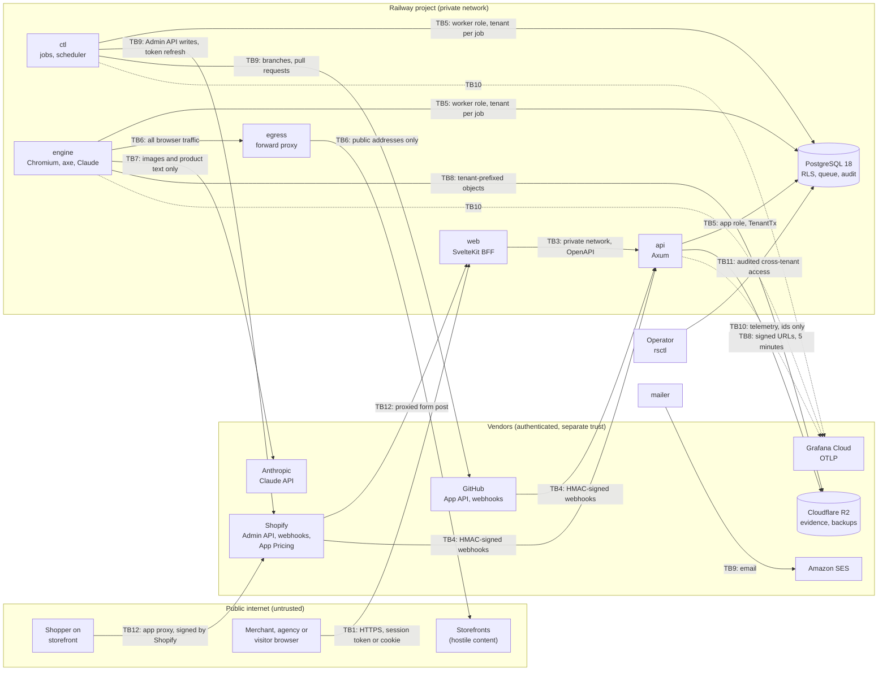

# Rampsmith threat model

- Version: 1 (WS-5 draft), 17 October 2026
- Baseline: OWASP ASVS Level 2 (PLAN §18)
- Code state assessed: `r0-foundations` at commit `e43f546`
- Owners: the builder of each release; the `security-auditor` subagent checks every change to
  authentication, tokens, webhooks, `egress`, encryption or row-level security (CLAUDE.md)

## How to read this document

Each threat maps to its control in PLAN §18 (or the section PLAN §18 points to) and carries a
status:

- **built (`path`)**: the control exists in the code at `e43f546`, at that path.
- **planned (R*n*)**: the control is designed in PLAN and not yet in the code; *n* is the release
  in PLAN §5 that needs it. "R0 step *k*" refers to the order of work in PLAN §27.
- **founder**: an account setting only the founder can make (`docs/FOUNDER_SETUP.md`).

At `e43f546` the repository holds the data layer, the job queue, telemetry, the `api` skeleton
(health and readiness only), the shared HTTP middleware, `claims-lint` and the pull-request gate.
`web`, `ctl`, `engine`, `egress`, `rsctl` and the Shopify, GitHub and encryption crates do not
exist yet, so every control on them is planned. The envelope-encryption crate landed on
`r0-foundations` after `e43f546` (commit `b366419`, ADR-021); the next review moves its rows to
built once it merges.

## Review cadence (PLAN §18)

- Reviewed and re-versioned at every release gate (R0, R1, R2, R3, R4), before the
  `release-verifier` runs. A row moves to built only with a path and a passing test.
- Reviewed with the `security-auditor` subagent whenever a change touches authentication,
  tokens, webhooks, `egress`, encryption, row-level security, secrets handling or response
  headers.
- Reviewed after any security incident, any new subprocessor, and any new external integration.
- An external penetration test before R3 and yearly after that feeds new rows into this file.

## Assets

| ID | Asset | Why it matters | Where it lives |
| --- | --- | --- | --- |
| A1 | Shopify offline access and refresh tokens | Write access to a store's products, files, pages and menus | `shopify_tokens` (ciphertext columns), process memory |
| A2 | GitHub App private key and installation tokens | Push branches and open pull requests on theme repositories | Environment variable; installation tokens in memory for one hour |
| A3 | Token master key (`TOKEN_MASTER_KEY`) | Unwraps every per-row data key | Railway variable only; offline encrypted vault after rotation |
| A4 | Store content and theme snapshots | Merchant intellectual property and unpublished changes | PostgreSQL, R2 |
| A5 | Evidence: screenshots, DOM snapshots | May show shopper-facing content; scrubbed before storage | R2, tenant-prefixed keys |
| A6 | Remediation record and audit log | The merchant's dated record of fixes; integrity matters most | `fixes`, `audit_log` |
| A7 | Dashboard accounts: emails, passkeys, sessions | Account takeover across every linked store | PostgreSQL |
| A8 | Storefront passwords | Access to password-protected storefronts | PostgreSQL, encrypted |
| A9 | Barrier reports from shoppers | Personal data (an email if the shopper gives one) | PostgreSQL |
| A10 | Plan state and entitlements | Revenue; limits on scans and AI use | PostgreSQL, Shopify App Pricing |
| A11 | Platform credentials: database, Anthropic, R2, SES, Turnstile, webhook secrets, Stripe | Each one is a pivot into a vendor account | Railway variables, GitHub Actions secrets |
| A12 | Merchant theme integrity | A bad patch can break a storefront | Merchant's repository or theme library, never written by Rampsmith (ADR-004) |
| A13 | Service availability | Webhooks must be answered; tokens must be refreshed | All services |

## Actors

| Actor | Trust | Reaches |
| --- | --- | --- |
| Merchant owner or staff | Authenticated by Shopify session token | `web` (embedded admin) |
| Agency user | Authenticated by passkey or emailed link | `web` (standalone dashboard) |
| Shopper | Anonymous | Theme app embed: statement link, barrier-report form through the app proxy |
| Free-scanner visitor | Anonymous, Turnstile-checked | `web` `/scan` |
| Shopify | Signed webhooks; Admin API over TLS | `api` webhook host; called by `ctl`, `api` |
| GitHub | Signed webhooks; REST API over TLS | `api` webhook host; called by `ctl` |
| Stripe (R3) | Signed webhooks | `api` webhook host |
| Anthropic | Vendor API; its output is untrusted | Called by `engine` |
| Operator (founder) | Highest privilege; every cross-tenant action audited | `rsctl`, Railway, vendor consoles |
| External attacker | None | Every public endpoint; scanned pages they control |
| Malicious tenant | Authenticated as their own tenant | Their own data; tries to reach others |
| Hostile storefront | Content Rampsmith loads | Chromium in `engine`, AI prompts |
| Compromised dependency | Code that runs in CI or in a service | Build and runtime |

## Trust boundaries and data flows

| Boundary | Crossing | Main control |
| --- | --- | --- |
| TB1 | Browser to `web` | TLS, session-token verification, cookies, CSP, origin check |
| TB2 | Shopify admin iframe to `web` | Per-shop `frame-ancestors`; App Bridge session tokens |
| TB3 | `web` to `api` | Private network only; browsers never call `api` (ADR-005) |
| TB4 | Vendors' webhooks to `api` | HMAC over the raw body, constant-time compare, 401 on failure, dedupe |
| TB5 | Services to PostgreSQL | Roles without `BYPASSRLS`; row-level security; `TenantTx` |
| TB6 | `engine` to the internet | `egress` resolves DNS and refuses non-public addresses |
| TB7 | `engine` to Anthropic | Minimal data; no tools; schema-validated output; human approval |
| TB8 | Services to R2 | Scoped API tokens; tenant-prefixed keys; short signed URLs |
| TB9 | `ctl` to Shopify and GitHub; `mailer` to SES (ADR-276) | Encrypted tokens; least-privilege scopes; idempotent writes |
| TB10 | Services and CI to vendors | Pinned actions and images; secrets only in GitHub and Railway |
| TB11 | Operator to production | `rsctl` with audit; break-glass database access |
| TB12 | Shopper to `web` through the app proxy | Shopify's app proxy signature; rate limits; minimal fields |

## STRIDE by component

S spoofing, T tampering, R repudiation, I information disclosure, D denial of service,
E elevation of privilege.

### web (SvelteKit backend-for-frontend)

| ID | STRIDE | Threat | Control (PLAN) | Status |
| --- | --- | --- | --- | --- |
| W1 | S | Forged or replayed embedded-admin request | Fresh App Bridge session token on every request, forwarded to `api` for verification (§14) | planned (R0 step 8) |
| W2 | S | Dashboard account takeover | Passkeys; single-use emailed link valid 15 minutes; hashed 256-bit session ids; 7-day idle and 30-day absolute expiry; rotation on sign-in and role change (§16) | planned (R2) |
| W3 | T | Cross-site request forgery | `SameSite=Lax`, `HttpOnly`, `Secure` cookies; SvelteKit origin check (§18) | planned (R0 step 8) |
| W4 | T | Script injection | Nonce-based `script-src`, no `unsafe-inline` or `unsafe-eval`; `{@html}` banned except one sanitized component (§8, §18) | planned (R0 step 8) |
| W5 | T | Clickjacking of the admin | `frame-ancestors` computed per shop; `'none'` elsewhere (§18) | planned (R0 step 8) |
| W6 | I | Tokens reach the browser | BFF: tokens stay server-side; browsers never call `api` (ADR-005) | planned (R0 step 8) |
| W7 | I | Free-scanner results exposed | Results `noindex`, never public; full report only after double opt-in (§16) | planned (LAUNCH B) |
| W8 | D | Free scanner used to hammer a third party | 3 scans per IP and 1 per domain per day; Turnstile; three-page budget; 24-hour cache; same `egress` guard (§16, §18) | planned (LAUNCH B) |
| W9 | D | Barrier-report form abuse | App proxy signature check; per-shop rate limit; minimal fields | planned (R1) |
| W10 | E | Plan-gated feature used without paying | One entitlements function read by API, scheduler and UI (§20) | planned (R2) |
| W11 | I | Third-party scripts leak data | No third-party analytics, pixels or session replay (§19) | planned (R0 step 8) |

### api (Axum control plane)

| ID | STRIDE | Threat | Control (PLAN) | Status |
| --- | --- | --- | --- | --- |
| P1 | S | Session token forged or reused for another shop | HS256 with the client secret; `aud`, `exp`, `nbf` (5 s leeway), `dest` as a `*.myshopify.com` host, `iss` checked (§14) | planned (R0 step 7) |
| P2 | S | Webhook forged | HMAC-SHA256 of the raw body, constant-time compare, 401 on failure (§14, §18) | planned (R1) |
| P3 | T | Webhook replayed | Dedupe on the provider's event id; process only the stored copy (§18) | planned (R1) |
| P4 | I | Secrets or signatures in logs | `Authorization`, `Cookie`, `Set-Cookie`, `X-Shopify-Hmac-Sha256`, `X-Hub-Signature-256` and `Stripe-Signature` marked sensitive before the trace layer | built (`crates/http-kit/src/middleware.rs`) |
| P5 | I | Panic or internal error leaks state | Panic payload neither logged nor returned; every error leaves as problem+json with an enumerated code | built (`crates/http-kit/src/middleware.rs`, `crates/http-kit/src/error.rs`) |
| P6 | I | Database URL printed | Configuration wraps it in `secrecy::SecretString`; errors never echo values | built (`crates/api/src/config.rs`) |
| P7 | D | Oversized or slow requests | 1 MiB body limit; 30 s timeout answered 503 | built (`crates/http-kit/src/middleware.rs`) |
| P8 | D | Starting with bad configuration | Typed configuration parsed at boot; a missing or malformed value stops the process | built (`crates/api/src/config.rs`) |
| P9 | D | Traffic sent before the schema is ready | `/readyz` checks the database and the migration version | built (`crates/api/src/health.rs`) |
| P10 | E | Cross-tenant access through a handler | Repository functions accept only `&mut TenantTx`; RLS beneath (§9, ADR-006) | built (`crates/db/src/tx.rs`); handlers planned (R1) |
| P11 | E | Agency member exceeds their role | Owner, admin, member, viewer roles checked per action; store links scoped and revocable (§16) | planned (R2) |
| P12 | D | Abuse of authenticated endpoints | In-process rate limits (`governor`) (§7, ADR-012) | planned (R1) |

### ctl (Rust jobs and scheduler)

| ID | STRIDE | Threat | Control (PLAN) | Status |
| --- | --- | --- | --- | --- |
| C1 | T | Lost refresh-token race overwrites a rotated token | Compare-and-swap on `shopify_tokens.version`; a lost race re-reads (§14) | built (schema: `crates/db/migrations/20261017000002_core_tables.sql`); logic planned (R0 step 7) |
| C2 | T | Data fix overwrites a merchant's later edit | Write only if the current value equals the stored "before"; undo only if it still equals "after" (§10, §12) | planned (R1) |
| C3 | T | A stale worker completes a job twice | Lease fenced by attempt number; an outdated lease cannot heartbeat, complete or fail | built (`crates/queue/src/ops.rs`, `crates/queue/tests/kill.rs`) |
| C4 | R | Fix applied without a record of who approved it | `approved_by` and `approved_at` set together; AI fixes record model and prompt version | built (schema: `crates/db/migrations/20261017000002_core_tables.sql`); workflow planned (R1) |
| C5 | I | Token decrypted into logs | Per-row data keys, AES-256-GCM, master key only in the environment, `secrecy` wrappers (§14, §18) | planned (R0 step 7) |
| C6 | D | Shop loses access because a refresh was missed | Refresh within 10 minutes of expiry; at least weekly job per shop; alert on any refresh failure (§14, §21) | planned (R0 step 7) |
| C7 | E | Two schedulers run at once | Leadership through `pg_try_advisory_lock` on a dedicated connection (§10) | planned (R1) |
| C8 | I | Email sent to the wrong recipient twice | Idempotency key per email (§10); a delivery ledger that also claims a row only when no live attempt holds it, and a lease check before the SES call (ADR-271, ADR-276) | built (`packages/engine/src/email/ledger.ts`) |

### engine (TypeScript workers: Chromium, axe-core, Claude)

| ID | STRIDE | Threat | Control (PLAN) | Status |
| --- | --- | --- | --- | --- |
| E1 | E | Hostile page exploits Chromium | Sandbox on where the host allows it, off and logged where Railway refuses it (ADR-265); non-root container; fresh context per page; time and memory limits; Playwright updated within 7 days (§18) | planned (R0 step 9) |
| E2 | I | Server-side request forgery through a scanned URL | All browser traffic through `egress`; only the verified store and Shopify CDN hosts reachable (§11, §18) | planned (R0 step 9) |
| E3 | T | Prompt injection from page or product text | No tools, no secrets; untrusted text passed as delimited data; JSON Schema output validated with Ajv; human approval before anything ships (§13, §18) | planned (R1) |
| E4 | T | Malformed job payload | Payloads validated against the generated JSON Schema; contract drift fails CI (§10, ADR-009) | built (drift check: `.github/workflows/ci.yml` job `contracts`); payload validation planned (R1) |
| E5 | T | Worker killed mid-job duplicates a side effect | Lease fencing shared with Rust; kill-mid-job tests | built (`packages/queue/src/protocol.ts`, `packages/queue/test/kill.test.ts`) |
| E6 | I | Shopper personal data captured in evidence | Form values, emails and phone patterns scrubbed before storage; no form with personal data submitted; checkout never entered (§11, §18) | planned (R1) |
| E7 | D | One store starves the queue | At most 4 running pages per scan; per-plan caps per tenant (§10) | planned (R1) |
| E8 | D | Bot challenge leads to evasion | Challenges never solved or evaded; scan reported as blocked (§11) | planned (R1) |
| E9 | I | Unverified site scanned | Scans only on installed stores or domains proven by DNS TXT or meta tag (§11) | built (schema: `sites.verified_at` and `verification_method` pair); enforcement planned (R1) |

### egress (forward proxy, `egress-guard`)

| ID | STRIDE | Threat | Control (PLAN §18) | Status |
| --- | --- | --- | --- | --- |
| G1 | I | Request to loopback, private, link-local (cloud metadata), CGNAT, unique-local or IPv4-mapped addresses | Proxy resolves DNS itself and refuses those ranges | planned (R0 step 9) |
| G2 | T | DNS rebinding | Resolve and connect in one place; re-check on every redirect | planned (R0 step 9) |
| G3 | D | One page fetches without end | Request budget per page | planned (R0 step 9) |
| G4 | E | Another service uses the proxy | Reachable only by `engine` on the private network (§22) | planned (R0 step 9) |
| G5 | T | Address checks wrong at the edges | Property tests and fuzzing on the address checks (§18) | planned (R0 step 9) |

### PostgreSQL 18

| ID | STRIDE | Threat | Control (PLAN) | Status |
| --- | --- | --- | --- | --- |
| D1 | I | One tenant reads another's rows | RLS policy `tenant_id = app_current_tenant()` on every tenant table, including each partition | built (`crates/db/migrations/20261017000002_core_tables.sql`) |
| D2 | E | Application bypasses RLS | `rampsmith_app` and `rampsmith_worker` are NOLOGIN group roles, not owners, without `BYPASSRLS` | built (`crates/db/migrations/20261017000001_roles_and_tenant_context.sql`) |
| D3 | I | Query forgets to set the tenant | `app_current_tenant()` raises when `app.tenant_id` is unset or empty; `TenantTx` sets it with `set_config(..., true)` | built (`crates/db/migrations/20261017000001_roles_and_tenant_context.sql`, `crates/db/src/tx.rs`) |
| D4 | T | Row points at another tenant's row | Composite foreign keys on `(id, tenant_id)` (ADR-017) | built (`crates/db/migrations/20261017000002_core_tables.sql`) |
| D5 | I | Isolation regresses unnoticed | Two-tenant isolation suite on every pull request | built (`crates/db/tests/tenancy.rs`, `.github/workflows/ci.yml` job `rust`) |
| D6 | R | Audit history rewritten | `audit_log` has no update or delete grants; triggers reject update, delete and truncate, even by the owner | built (`crates/db/migrations/20261017000002_core_tables.sql`) |
| D7 | I | Jobs leak across tenants | App role sees only its tenant's jobs; workers see all jobs | built (`crates/db/migrations/20261017000003_jobs.sql`) |
| D8 | I | Plaintext tokens at rest | Only ciphertext columns and a key id exist for tokens | built (schema: `crates/db/migrations/20261017000002_core_tables.sql`); encryption planned (R0 step 7) |
| D9 | D | Data loss | Railway PITR plus nightly encrypted `pg_dump` to a separate R2 bucket; quarterly restore drill (§22) | planned (LAUNCH B) |
| D10 | E | Operator reads across tenants without trace | Cross-tenant reads only in `rsctl`, each one audited; break-glass access notifies a second person (§9, §18) | planned (R1) |

### Cloudflare R2

| ID | STRIDE | Threat | Control (PLAN) | Status |
| --- | --- | --- | --- | --- |
| O1 | I | Evidence of one tenant served to another | Tenant-prefixed keys; signed URLs valid 5 minutes, issued only after an authorization check (§18) | planned (R1) |
| O2 | I | Leaked R2 key reads every bucket | API tokens scoped to named buckets with Object Read & Write only | founder (`docs/FOUNDER_SETUP.md`) |
| O3 | I | Evidence kept longer than stated | Lifecycle rule: 90 days, except evidence attached to a fix (§19, §22) | planned (R1); rule set by founder |
| O4 | T | Backups altered or lost with production | Separate backup bucket; `age` encryption; 30 daily and 12 monthly (§22) | planned (LAUNCH B) |

### Claude (Anthropic API)

| ID | STRIDE | Threat | Control (PLAN) | Status |
| --- | --- | --- | --- | --- |
| L1 | T | Model output used unchecked | Structured outputs, Ajv validation; malformed output fails the job; human approval for every AI-written fix (§13) | planned (R1) |
| L2 | I | Personal data sent to the model | Only the image, product title and type; never customer data (§13, §19) | planned (R1) |
| L3 | E | Model acts on injected instructions | No tools and no secrets in any call (§18) | planned (R1) |
| L4 | D | Runaway AI spend | Per-tenant monthly budget enforced before the call; workspace spend limit in the Claude Console; spend-limit responses open the circuit breaker (§13, ADR-142) | planned (R1); console limit by founder |
| L5 | D | Provider outage stalls scans | Backoff on 429 and overload; circuit breaker; scans continue without AI drafts (§13) | planned (R1) |

### GitHub App

| ID | STRIDE | Threat | Control (PLAN §15) | Status |
| --- | --- | --- | --- | --- |
| H1 | E | App changes CI or merges code | Permissions: metadata read; contents, pull requests, checks read and write; workflows not requested; never merges or pushes to a protected branch | planned (R2) |
| H2 | I | Private key exposed | Key only in the environment; rotated on a schedule with overlap; installation tokens in memory for one hour | planned (R2) |
| H3 | S | JWT replay or clock drift | RS256 JWT issued 60 s in the past, expiring within 10 minutes | planned (R2) |
| H4 | S | Forged GitHub webhook | `X-Hub-Signature-256` HMAC check; header redacted from logs | redaction built (`crates/http-kit/src/middleware.rs`); verification planned (R2) |
| H5 | I | Secrets read from a theme repository | Reads limited to theme directories; `.env*` and key files never read | planned (R2) |
| H6 | T | Fix branch overwrites the merchant's work | Only branches Rampsmith created; re-derive on a new base instead of rebasing | planned (R2) |

### Shopify

| ID | STRIDE | Threat | Control (PLAN) | Status |
| --- | --- | --- | --- | --- |
| S1 | E | App holds more access than it needs | Scopes limited to PLAN §14's list; no theme write; no customer scopes; protected customer data opted out | planned (R1) |
| S2 | T | Theme modified by the app | Never write theme files (ADR-004); storefront change only through the theme app extension; requirement 5.1.1 (ADR-141); a downloadable theme is also what requirement 1.1.3 forbids | planned (R1), by design |
| S3 | S | Shop domain spoofed in claims or rows | `dest` validated as `*.myshopify.com`; `shop_domain` constrained by a database check | built (schema check: `crates/db/migrations/20261017000002_core_tables.sql`); token check planned (R0 step 7) |
| S4 | I | Data kept after uninstall | `app/uninstalled` revokes tokens; `shop/redact` deletes the shop's data within 30 days (§14, §19) | planned (R2) |
| S5 | I | Customer data request unanswered | `customers/data_request` and `customers/redact` handled within 30 days, 401 on bad HMAC (§19) | planned (R2) |
| S6 | D | Throttling breaks scans | Cost-aware throttling from `extensions.cost.throttleStatus`; bulk operations for catalogs (§14) | planned (R1) |
| S7 | R | Plan state disputed | Plan from `plan_handle` plus an active-subscription check on each load and daily (§20) | planned (R2) |

### Cross-cutting: build, supply chain and operations

| ID | STRIDE | Threat | Control (PLAN) | Status |
| --- | --- | --- | --- | --- |
| X1 | T | Compromised GitHub Action | Every action pinned to a full commit SHA; workflow `permissions: read-all`; `persist-credentials: false` | built (`.github/workflows/ci.yml`) |
| X2 | T | Malicious install script | pnpm runs no dependency lifecycle script unless allow-listed; frozen lockfile in CI | built (`pnpm-workspace.yaml`, `.github/workflows/ci.yml`) |
| X3 | T | Fresh malicious release pulled in | Renovate waits a 7-day minimum release age | built (`renovate.json`) |
| X4 | T | Vulnerable or unlicensed crate | `cargo-deny`: advisories, licenses, sources, bans on OpenSSL | built (`deny.toml`, `.github/workflows/ci.yml`) |
| X5 | T | Vulnerable image | CycloneDX SBOM and a scan that fails on fixable high or critical findings; base images pinned by digest; runs as UID 10001 | built for `api` (`.github/workflows/ci.yml` job `images`, `infra/api.Dockerfile`); other images planned with their services |
| X6 | T | Tampered image between build and deploy | Signed build provenance; deploy by digest (§24) | planned (LAUNCH B, release workflow) |
| X7 | I | Secret committed | Secrets only in GitHub Actions secrets and Railway variables; GitHub secret scanning and push protection | founder (repository setting) |
| X8 | I | Personal data or tokens in telemetry | Spans carry ids, never payloads; export only when an endpoint is configured | built (`crates/telemetry/src/init.rs`, ADR-019) |
| X9 | E | Vendor console takeover | Hardware security keys on GitHub, Railway, Shopify Partners, Cloudflare, Anthropic, AWS and Stripe (§18) | founder |
| X10 | R | Unexplained production change | Protected `production` environment with manual approval; branch ruleset on `main` (§24) | founder (row 14) and planned (LAUNCH B) |

## Residual risks and open items

- The code-fix channels may conflict with App Store requirements 5.1.1 and 1.1.3 (ADR-141); the
  theme package, which the merchant downloads, is the one 1.1.3 names. Founder and architect
  decision.
- Shopify may never send the customer compliance topics to an app without customer or order
  access (ADR-142). Barrier-report deletion therefore also needs the merchant's delete control
  and a privacy contact; both are planned with the form in R1.
- `TOKEN_MASTER_KEY` loss is survivable by design (merchants re-authenticate through token
  exchange, PLAN §22); its theft is not. Rotation runbook planned (LAUNCH B).
- The `api` image runs on `debian:trixie-slim` until a distroless digest can be verified
  (ADR-020).
